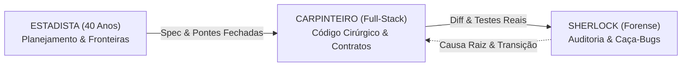

# ⚡ Suíte Henke — 58 Macro-Skills & Portões Métricos para Vibecoding de Respeito

> **"De um vibecoder para vibecoders: o kit definitivo para a sua IA parar de fazer cagada, não apagar metade do seu projeto, não forjar testes e finalmente codar como engenheiro sênior."**  
> *(E sejamos sinceros: a galera de TI 'raiz' adora torcer o nariz e zoar quem vibecoda... mas na primeira sexta-feira às 18h com o servidor caindo, até eles vão clonar esse repositório no sigilo pra salvar o dia).*

A **Suíte Henke** usa o padrão aberto **Agent Skills (`SKILL.md`)** e é compatível nativamente com **Google Antigravity**, **Gemini CLI**, **Claude Code**, **Codex**, **Devin**, **Cursor** e qualquer harness de IA agentic moderno.

---

## 🎯 Por que essa suíte existe? (O pesadelo clássico do vibecoding)

Quem cria sistemas com IA no fluxo de vibecoding conhece bem o ciclo da loucura:
1. **O Apagão Silencioso:** Você pede para a IA ajustar um botão e ela deleta 400 linhas do seu backend, deixando um infame `// ... resto do seu código continua aqui`.
2. **O Visual de Template Cafona:** Ela cospe gradientes roxo-neon com ciano, botões cheios de emojis e cards aninhados que gritam: *"fui gerado por IA preguiçosa"*.
3. **A Amnésia de Sessão:** Você fica 3 dias sem abrir o repo, volta e nem você nem a IA lembram onde pararam, por que uma função existe ou o que falta testar.
4. **O Chute Aleatório no Debug:** O servidor dá erro 500 e a IA tenta 7 chutes no escuro, quebrando o banco, o contrato front-back e a sua paciência.
5. **A Vitória Teatral (Falso-Verde):** A IA afirma que "todos os testes passaram com 100% de sucesso", mas quando você vai ver, ela escreveu testes sem nenhuma asserção real (`assertless`), criou mocks circulares ou usou truques de CSS (`.sr-only`) para forçar o teste a passar.

A **Suíte Henke v4.0** nasceu para aniquilar esses 5 problemas combinando **58 Macro-Skills especializadas**, a **CLI unificada `henke`** (`scripts/henke_cli.py`) e **14 Portões Mecânicos determinísticos (fail-closed exit code)**.

---

## 🏛️ A Filosofia dos 3 Arquétipos Operacionais

Não existe "uma IA genérica que faz tudo ao mesmo tempo". Para blindar o projeto, a Suíte Henke opera sob 3 posturas mentais distintas e complementares:



1. **🕵️ O SHERLOCK HOLMES (Perito Forense, Banca Adversarial & Auditor Implacável):**
   - **Postura:** Desconfiança metódica, raciocínio abdutivo, consenso multi-modelo e evidência física irrefutável.
   - **Regra:** Nunca acredita em afirmação sem prova, nunca altera código durante a investigação e proíbe "severidade teatral" sem cadeia de exploração real.
   - **Skills:** [`henke-audit-seguranca`](./henke-audit-seguranca/SKILL.md), [`henke-audit-banca`](./henke-audit-banca/SKILL.md), [`henke-audit-perf`](./henke-audit-perf/SKILL.md), [`henke-test-mutantes`](./henke-test-mutantes/SKILL.md), [`henke-debug-raiz`](./henke-debug-raiz/SKILL.md), [`henke-audit-vibecode`](./henke-audit-vibecode/SKILL.md).
   - **Portões Mecânicos:** [`repo_signals.py`](./scripts/repo_signals.py), [`hazard_scan.py`](./scripts/metricas/hazard_scan.py), [`coverage_ledger.py`](./scripts/metricas/coverage_ledger.py), [`a11y_scan.py`](./scripts/metricas/a11y_scan.py), [`mutant_hunt.py`](./scripts/metricas/mutant_hunt.py).

2. **🔨 O CARPINTEIRO BRABO (Engenheiro Full-Stack Pragmático):**
   - **Postura:** O bisturi cirúrgico. Constrói com a menor mudança necessária (Minimal Diff), alinha contratos rígidos entre pontas, blinda integrações LLM/RAG e nunca quebra pontes por falta de cuidado.
   - **Regra:** Nem código a mais (`touched ⊆ declared` via `spec_drift`), nem código a menos (`declared ⊆ touched` via `contract_closure`).
   - **Skills:** [`henke-code-cirurgico`](./henke-code-cirurgico/SKILL.md), [`henke-code-ponte`](./henke-code-ponte/SKILL.md), [`henke-code-contratos`](./henke-code-contratos/SKILL.md), [`henke-code-llm`](./henke-code-llm/SKILL.md), [`henke-ops-observa`](./henke-ops-observa/SKILL.md), [`henke-blindagem`](./henke-blindagem/SKILL.md).
   - **Portões Mecânicos:** [`spec_drift.py`](./scripts/spec_drift.py), [`contract_closure.py`](./scripts/metricas/contract_closure.py), [`ratchet.py`](./scripts/metricas/ratchet.py), [`assertless_scan.py`](./scripts/metricas/assertless_scan.py), [`mutant_hunt.py`](./scripts/metricas/mutant_hunt.py), [`run_state.py`](./scripts/run_state.py).

3. **🏛️ O ESTADISTA DE 40 ANOS (Planejador de Longo Alcance):**
   - **Postura:** Visão de estadista. Premedita a arquitetura, desenha fronteiras limpas (3 Gavetas: UI $\to$ Core $\to$ Executores) e cria matrizes de pré-mortem antes de encostar no código.
   - **Regra:** Nenhum recurso é criado sem especificação clara de escopo, pontes de contrato e plano de reversão.
   - **Skills:** [`henke-plan-historias`](./henke-plan-historias/SKILL.md), [`henke-plan-mvp`](./henke-plan-mvp/SKILL.md), [`henke-prepara`](./henke-prepara/SKILL.md).
   - **Portões Mecânicos:** [`TEMPLATE.md`](./docs/designs/TEMPLATE.md), [`fence_check.py`](./scripts/metricas/fence_check.py).

---

## 🚦 Os Portões Mecânicos & CLI Global (`henke`)

Texto em prosa não segura agente de IA sob pressão. O que protege código de verdade são **scripts com código de saída (`exit 0` = aprovado, `exit 1` = reprovado, `exit 2` = erro/fail-closed)**:

| Portão Mecânico | Script | O que ele barra fisicamente |
|---|---|---|
| **CLI Global & Runner Auditado** | [`henke_cli.py`](./scripts/henke_cli.py) | **Execução sem prova (`henke exec`)**: roda os testes reais, extrai contagem, calcula `stdout_sha256` e grava em `.henke/exec_log.jsonl` (hash-encadeado) e `.henke/LEDGER.json`. Orquestra `init`, `doctor`, `route`, `exec`, `check`, `gate`, `approve`, `scope`, `goldfish`, `run`, `report`, `status`, `setup` e `auto`. |
| **Máquina de Estados por Run** | [`run_state.py`](./scripts/run_state.py) | **Auto-atestado de vitória (`STATE-DERIVED-CONFLICT`)**: gerencia `.henke/runs/<run_id>.json` e deriva `outcome` (`verified\|failed\|blocked`) mecanicamente dos portões e do `exec_log.jsonl`. |
| **Fechamento de Contrato** | [`contract_closure.py`](./scripts/metricas/contract_closure.py) | **Código de menos**: barra arquivos declarados ausentes, traversal em pontes (`PATH-TRAVERSAL-BRIDGE`) e pontes quebradas (símbolos sem export/import real `BROKEN-BRIDGE-IMPORT`, canais IPC literais `"clips:bake"` ou rotas `ROUTE:METHOD /path`). |
| **Deriva de Especificação** | [`spec_drift.py`](./scripts/spec_drift.py) | **Código a mais / à toa**: barra qualquer arquivo alterado no `git status` que não conste na seção `## 4. Escopo Declarado` da spec, bloqueando escopos curingas (`WILDCARD-SCOPE-FORBIDDEN`). |
| **Dossiê de Cobertura & SHA-256** | [`coverage_ledger.py`](./scripts/metricas/coverage_ledger.py) | **Pular arquivos difíceis**: indexa 100% dos arquivos com hash SHA-256. Reprova unidades `pending`, arquivos alterados pós-auditoria (`STALE-HASH`), diluição de `out_of_scope` ou cobertura abaixo de 90%. |
| **Metaconfiguração & Anti-TOCTOU** | [`metaconfig_diff.py`](./scripts/metricas/metaconfig_diff.py) | **Mutação furtiva de build**: barra alterações em `scripts`, lifecycle hooks (`pretest`, `postinstall`), lockfiles, arquivos untracked (`??`), dependências e metaconfiguração (`package.json`, `pyproject.toml`, `Cargo.toml`, `conftest.py`, `Makefile`, CI) sem autorização humana explícita. |
| **Varredura de Perigos (Hazards)** | [`hazard_scan.py`](./scripts/metricas/hazard_scan.py) | **Riscos em código, IaC, CI/CD e bundle**: análise intraprocedural (`XSS-RAW-HTML`, `UNBOUNDED-CONCURRENCY`, `IMDS-V1`), `SHELL-INJECTION`, `HARDCODED-SECRET`, `SQL-CONCAT`, `PATH-TRAVERSAL`, `WEAK-CRYPTO`, IaC Multi-Cloud, Pentest (`IDOR`, `SSRF`, `JWT`, `CORS`, `PROTO-POLLUTION`), CI/CD (`CI-PWN-REQUEST`, `CI-CURL-PIPE-SH`, `CI-SECRET-ECHO`) e proteção contra manifesto plantado. |
| **Caça a Testes Fantasmas** | [`assertless_scan.py`](./scripts/metricas/assertless_scan.py) | **Testes teatrais**: reprova testes sem nenhuma asserção real, testes puramente `mock-only` e testes engolindo erros com `catch` (`HIT-AND-SWALLOW`). |
| **Caça a Mutantes no Diff** | [`mutant_hunt.py`](./scripts/metricas/mutant_hunt.py) | **Testes fracos que aprovam código quebrado**: injeta mutações AST cirúrgicas nas linhas alteradas (`==` $\leftrightarrow$ `!=`, `+` $\leftrightarrow$ `-`, `True` $\leftrightarrow$ `False`) e barra se a suíte deixar mutantes sobreviverem (`SURVIVED-MUTANT`). |
| **Scanner Anti-Cheat de A11y** | [`a11y_scan.py`](./scripts/metricas/a11y_scan.py) | **Trapaças visuais**: barra `.sr-only` duplicando texto visível (`A11Y-SR-ONLY-DUPLICATE`), elementos interativos ocultos (`A11Y-HIDDEN-INTERACTIVE`) e botões vazios (`A11Y-EMPTY-CONTROL`), preservando `.sr-only` legítimo em botões icon-only. |
| **Complexidade vs Cobertura (CRAP)** | [`crap_score.py`](./scripts/metricas/crap_score.py) | **Código espaguete sem teste**: mede complexidade ciclomática poliglota (Python, TypeScript, Rust, Go) ponderada pela cobertura de testes. |
| **Catraca Anti-Regressão** | [`ratchet.py`](./scripts/metricas/ratchet.py) | **Piora gradual**: barra qualquer commit que piore as métricas em relação ao baseline do repositório. |
| **Fronteira Arquitetural (Fence)** | [`fence_check.py`](./scripts/metricas/fence_check.py) | **Violação de camadas**: garante que a UI nunca importe diretamente executores pesados de I/O ou backend interno (`ui -> core -> exec`). |

---

## 🧠 Como Funciona o Roteamento em 2 Estágios (`/henke-skills`)

Você **não precisa memorizar** 58 skills nem adivinhar qual chamar primeiro. Basta rodar:

```bash
/henke-skills "investiga por que o login tá dando timeout"
```

### O Despacho Inteligente:
1. **Estágio 0 (Descoberta Leve):** A IDE/CLI só injeta o nome e 1 linha de descrição no prompt. As 58 skills **não poluem o contexto de tokens**.
2. **Estágio 1 (Roteador Determinístico):** O script [`henke_router.py`](./scripts/henke_router.py) (ou `henke route`) analisa a intenção em milissegundos contra a fonte única da verdade (`SKILL.md` frontmatters + pontos de partida):
   - Aplica word-boundaries `\b`, desambiguação de verbos compostos (`"audita e corrige"`), afinidade com arquivos modificados (`_touched_files`) e a tabela de **Desambiguação Negativa** (`NEGATIVE_DISAMBIGUATION`, padrão *NVIDIA Skills Finder*).
   - Trava o **Modo de Operação** (`ANALISAR` por padrão em perguntas/auditorias; `requires_human_auth: true` em comandos `PUBLISH` como deploy, rollback ou faxina destrutiva).
   - Devolve **apenas as 1 a 3 skills essenciais** para a rodada atual (ou `skills: []` se a pergunta for externa), economizando até 93% de tokens de instrução.
3. **Transição Dinâmica de Domínio:** Se a investigação do `SHERLOCK` revelar que a falha não era na tela, mas sim no contrato IPC do backend, o protocolo faz o **handoff automático** para o `CARPINTEIRO` com [`henke-code-ponte`](./henke-code-ponte/SKILL.md) e [`henke-code-cirurgico`](./henke-code-cirurgico/SKILL.md).

---

## 📊 Benchmark Adversarial Oficial (`evals/bench_corpus.py`)

A eficácia da Suíte Henke é testada contra um corpus físico de **defeitos reais** e **controles legítimos**:

| Métrica | Base Original (`f2f9c64`) | Wave 1 (`f847f25`) | **Wave 5 (v4.0 Atual)** |
|---|---|---|---|
| **Cobertura Instrumental de Defeitos** | `3/15` (20,0%) | `11/15` (73,3%) | **`100,0%`** |
| **Defeitos Detectados (Recall)** | `3/15` (20,0%) | `11/15` (73,3%) | **`100,0%`** |
| **Controles Legítimos Aprovados (Zero Falso-Positivo)** | `0` | `1/1` (100%) | **`100%`** |
| **Canários Bilaterais (`canaries_metricas.py`)** | `5/5` | `38/38` | **`80/80` (100% PASS)** |
| **Inventário Validado (`validate_skills.py`)** | `49/49` | `49/49` | **`58/58` (100% PASS)** |

> **Prova física em monorepo real (`virusclip`):** O scanner varreu **491 arquivos** em segundos sem estourar limites, indexou **264 unidades de código** no `coverage_ledger.py` com SHA-256 e priorizou automaticamente as 3 superfícies mais perigosas sem nenhuma intervenção humana.

---

## 🧭 O Catálogo das 58 Macro-Skills

### 0. Orquestração Central & Governança (`henke-skills` / `henke-prepara`)
* [`henke-skills`](./henke-skills/SKILL.md): Orquestrador mestre e Chief of Staff (roteamento dinâmico em 5 fases, despacho determinístico e handoff operacional).
* [`henke-prepara`](./henke-prepara/SKILL.md): Bootstrap de governança — inicializa `.henke/`, cofre de decisões, diário e mapa da codebase.

### 1. Concepção & Ideias (`henke-plan-*`)
* [`henke-plan-radar`](./henke-plan-radar/SKILL.md): Radar de referências e benchmarking de produtos concorrentes reais.
* [`henke-plan-ideias`](./henke-plan-ideias/SKILL.md): Transforma desejos soltos em conceitos de produto sólidos.
* [`henke-plan-destrava`](./henke-plan-destrava/SKILL.md): Destravador de bloqueio criativo — sugere as 3 próximas features mais lógicas.
* [`henke-plan-mvp`](./henke-plan-mvp/SKILL.md): Guilhotina de escopo — corta o supérfluo para rodar a primeira versão hoje.
* [`henke-plan-historias`](./henke-plan-historias/SKILL.md): Traduz requisitos em cartões de tarefa sequenciais com critério de pronto.
* [`henke-plan-fluxo`](./henke-plan-fluxo/SKILL.md): Mapeia jornadas de usuário, transições de estado e telas em diagramas.

### 2. Memória Contínua & Diário (`henke-mem-*`)
* [`henke-mem-diario`](./henke-mem-diario/SKILL.md): Mantém o diário de bordo contínuo em `.henke/DIARIO.md`.
* [`henke-mem-retomada`](./henke-mem-retomada/SKILL.md): Responde "onde foi que eu parei?" em 1 minuto ao voltar ao projeto.
* [`henke-mem-decisoes`](./henke-mem-decisoes/SKILL.md): Cofre de Decisões Técnicas em `.henke/DECISOES.md` (evita regressão por IA).
* [`henke-mem-mapa`](./henke-mem-mapa/SKILL.md): Desenha o mapa do tesouro da codebase explicando o papel de cada pasta.
* [`henke-mem-faxina`](./henke-mem-faxina/SKILL.md): Caça arquivos zumbis, temporários e código morto (exige trava PUBLISH).

### 3. Arquitetura & Blindagem Estrutural (`henke-arch-*`)
* [`henke-arch-stack`](./henke-arch-stack/SKILL.md): Seleciona tecnologias enxutas e consolidadas, bloqueando dependências inchadas.
* [`henke-arch-pastas`](./henke-arch-pastas/SKILL.md): Arquitetura das 3 Gavetas (Visual $\to$ Core $\to$ Executores I/O).
* [`henke-arch-desmembrar`](./henke-arch-desmembrar/SKILL.md): Desmembra arquivos monstros (500+ linhas) em módulos profundos e coesos.
* [`henke-arch-monorepo`](./henke-arch-monorepo/SKILL.md): Monorepos limpos (Electron + Frontend + Backend) com execução em 1 comando.
* [`henke-arch-banco`](./henke-arch-banco/SKILL.md): Modelagem relacional descomplicada (SQLite modo WAL, busy_timeout e migrações limpas).
* [`henke-arch-seguranca`](./henke-arch-seguranca/SKILL.md): Blindagem estrutural contra vazamento de chaves e permissões excessivas.
* [`henke-arch-cloud`](./henke-arch-cloud/SKILL.md): Arquitetura e blindagem Multi-Cloud agnóstica (**AWS, Google Cloud GCP, Cloudflare e Containers/Serverless**): IAM menor privilégio, OIDC sem chave estática, buckets privados (S3/GCS/R2), IMDSv2 e travas anti-custo infinito.
* [`henke-blindagem`](./henke-blindagem/SKILL.md): Regras de ouro de escrita atômica, idempotência e controle de processos filhos.

### 4. Visual Profissional & Anti-AI-Slop (`henke-ui-*`)
* [`henke-ui-antislop`](./henke-ui-antislop/SKILL.md): Extermina clichês de IA (degradês roxo/neon, cards aninhados, sombras dramáticas).
* [`henke-ui-paleta`](./henke-ui-paleta/SKILL.md): Identidade visual com paletas harmônicas de alto contraste real.
* [`henke-ui-tipografia`](./henke-ui-tipografia/SKILL.md): Escala tipográfica, entrelinhas e espaçamentos profissionais.
* [`henke-ui-estados`](./henke-ui-estados/SKILL.md): Cobre os 4 estados obrigatórios de UI (Carregando, Vazio, Erro, Sucesso).
* [`henke-ui-feedback`](./henke-ui-feedback/SKILL.md): Resposta tátil a cliques, spinners elegantes e trava contra duplo-clique.
* [`henke-ui-responsivo`](./henke-ui-responsivo/SKILL.md): Adapta telas para celular, tablet e desktop sem quebras de layout.
* [`henke-ui-auditoria`](./henke-ui-auditoria/SKILL.md): Dá nota de 0 a 10 para o design com lista priorizada de refinamentos.

### 5. Construção Cirúrgica, Contratos & LLMs (`henke-code-*`)
* [`henke-code-ponte`](./henke-code-ponte/SKILL.md): Conecta frontend e backend com contratos tipados e canais IPC alinhados.
* [`henke-code-contratos`](./henke-code-contratos/SKILL.md): Engenharia e fechamento bilateral de contratos formais (**Zod, TypeBox, Pydantic, OpenAPI, tRPC, JSON Schema, IPC e Rotas HTTP**) validados por `contract_closure.py`.
* [`henke-code-llm`](./henke-code-llm/SKILL.md): **Engenharia segura de integrações LLM, RAG, Tool-Calling e Agentes**: bloqueia Prompt Injection direto/indireto, exige Structured Outputs validados por schema (`Pydantic`/`Zod`), timeouts, semáforos e fallback determinístico.
* [`henke-code-mock`](./henke-code-mock/SKILL.md): Cria fixtures hiper-realistas para desenvolver a tela antes do backend existir.
* [`henke-code-cirurgico`](./henke-code-cirurgico/SKILL.md): Bisturi de código — faz alterações milimétricas sem reescrever o arquivo inteiro.
* [`henke-code-formulario`](./henke-code-formulario/SKILL.md): Formulários acessíveis com validação amigável e UX fluida.
* [`henke-code-autentica`](./henke-code-autentica/SKILL.md): Autenticação completa e segura (login, cadastro, cookies HttpOnly e sessões).
* [`henke-code-integracao`](./henke-code-integracao/SKILL.md): Integração com serviços de terceiros, pagamentos e webhooks resilientes.
* [`henke-code-comentarios`](./henke-code-comentarios/SKILL.md): Documenta o "porquê" das decisões em português claro, eliminando comentários inúteis.
* [`henke-code-3d-scene`](./henke-code-3d-scene/SKILL.md): Cenas 3D na web (Three.js/Fiber) com descarte limpo de memória/VRAM.

### 6. Investigação & Debugging Forense (`henke-debug-*`)
* [`henke-debug-raiz`](./henke-debug-raiz/SKILL.md): Investigação científica de causa raiz: isola camadas, bissecta e exige prova física.
* [`henke-debug-frontend`](./henke-debug-frontend/SKILL.md): Diagnóstico de telas brancas, dados que somem e reatividade travada.
* [`henke-debug-backend`](./henke-debug-backend/SKILL.md): Diagnóstico de falhas 500, deadlocks de banco e workers em looping.
* [`henke-debug-console`](./henke-debug-console/SKILL.md): Análise forense de erros e warnings de terminal/console.
* [`henke-debug-rede`](./henke-debug-rede/SKILL.md): Diagnóstico de requisições de rede, CORS, timeouts e payloads quebrados.
* [`henke-debug-sanidade`](./henke-debug-sanidade/SKILL.md): Check-up preventivo de 30 segundos (build verde, testes passando, console limpo).
* [`henke-debug-reversao`](./henke-debug-reversao/SKILL.md): Reversão atômica de mudanças desastrosas sem perder o trabalho do usuário.

### 7. Auditoria Adversarial, Banca Multi-Modelo, Mutação & Refatoração (`henke-audit-*` / `henke-test-*` / `henke-refactor-*`)
* [`henke-audit-banca`](./henke-audit-banca/SKILL.md): **Banca adversarial multi-modelo (Protocolo Goldfish Todos-contra-Todos com quorum $\ge 2/3$)**: orquestra múltiplos modelos/subagentes independentes sobre um dossiê físico congelado (`coverage_ledger.py` + `hazard_scan.py`) com ataque cruzado na Rodada 2.
* [`henke-audit-vibecode`](./henke-audit-vibecode/SKILL.md): Caça gambiarras, trapaças de teste (`.sr-only`), métricas falsas e atalhos.
* [`henke-audit-seguranca`](./henke-audit-seguranca/SKILL.md): Auditoria profunda contra vulnerabilidades, injeções e segredos expostos.
* [`henke-audit-pentest`](./henke-audit-pentest/SKILL.md): **Red Team local e simulação adversarial controlada**: caça IDOR/BOLA, bypass de JWT, SSRF, race conditions (TOCTOU) e prototype pollution com PoC reprodutível em `localhost`.
* [`henke-audit-cobertura`](./henke-audit-cobertura/SKILL.md): Auditoria determinística de cobertura ($\ge 90\%$) por SHA-256 com `coverage_ledger.py`, dossiê de premissas (`enforced`/`unenforced`) e `render-gaps`.
* [`henke-audit-perf`](./henke-audit-perf/SKILL.md): **Auditoria forense de performance e escalabilidade**: caça hotspots CRAP, queries N+1 em loops, I/O síncrono em rotas async, concorrência sem semáforo e memory leaks com medição antes/depois via `henke exec`.
* [`henke-test-mutantes`](./henke-test-mutantes/SKILL.md): **Caça a testes fracos por mutação cirúrgica de AST no diff (`mutant_hunt.py`)**: injeta mutações de operadores nas linhas alteradas e exige que a suíte mate os mutantes (`kill_rate >= 80%`).
* [`henke-refactor-duplicado`](./henke-refactor-duplicado/SKILL.md): Unifica código repetido e lógicas duplicadas em uma fonte da verdade.
* [`henke-refactor-nomes`](./henke-refactor-nomes/SKILL.md): Renomeia variáveis e funções crípticas para nomes que se explicam sozinhos.

### 8. Operações, Observabilidade & Publicação Segura (`henke-ops-*`)
* [`henke-ops-env`](./henke-ops-env/SKILL.md): Configuração de variáveis de ambiente com geração automática de `.env.example`.
* [`henke-ops-observa`](./henke-ops-observa/SKILL.md): **Observabilidade estruturada e telemetria**: logs JSONL com correlação `trace_id`/`run_id`, redaction de segredos/PII, healthchecks profundos e eliminação de catches silenciosos.
* [`henke-ops-preflight`](./henke-ops-preflight/SKILL.md): Checklist rigoroso de pré-voo antes de publicar ou fazer deploy.
* [`henke-ops-deploy`](./henke-ops-deploy/SKILL.md): Automação para subir apps em servidores, containers Docker ou Vercel.

---

## ⚡ Como Instalar (1 Comando)

### Windows (PowerShell):
```powershell
git clone https://github.com/erickhenke2-eng/henke-skills-vibecoding.git
cd henke-skills-vibecoding
python -m pip install -r requirements.txt
powershell -ExecutionPolicy Bypass -File .\install.ps1
```

### Linux / macOS (Bash):
```bash
git clone https://github.com/erickhenke2-eng/henke-skills-vibecoding.git
cd henke-skills-vibecoding
python3 -m pip install -r requirements.txt
chmod +x install.sh && ./install.sh
```

### Alternativa via `pipx` / `pip` (CLI `henke` direto no PATH):
```bash
cd henke-skills-vibecoding
pipx install .        # ou: python -m pip install .
henke doctor          # entrypoint [project.scripts] -> scripts.henke_cli:main
```

> **O que o instalador faz:**  
> Ele valida a estrutura de todas as 58 skills, instala os scripts, o `docs/designs/TEMPLATE.md`, os wrappers `bin/henke` (sh) e `bin/henke.cmd` (Windows) e os portões mecânicos em `scripts/`, publicando atomicamente nos 4 diretórios canônicos de agentes:
> - `~/.gemini/config/skills` (Google Antigravity e Gemini CLI)
> - `~/.claude/skills` (Anthropic Claude Code)
> - `~/.agents/skills` (OpenAI Codex / Padrão Aberto)
> - `~/.gemini/skills` (Mirror de Compatibilidade)
>
> Os wrappers ficam em `<destino>/bin/` e resolvem `<destino>/scripts/henke_cli.py` automaticamente. **Ao final, o instalador imprime a instrução de PATH** — adicione um dos diretórios `bin/` listados ao `PATH` para chamar `henke` de qualquer lugar (ou use a alternativa `pipx install .` acima, que registra o entrypoint automaticamente).

---

## 🧪 Como Rodar os Testes e o Benchmark Localmente

Para provar a robustez dos portões mecânicos na sua máquina:

```bash
# 1. Valida estrutura das 58 skills
python scripts/validate_skills.py

# 2. Roda os 5 canários comportamentais do PROTOCOLO
python evals/canaries.py

# 3. Roda os 80 canários bilaterais dos portões métricos (reprova o ruim e aprova o bom)
python evals/canaries_metricas.py

# 4. Executa a suíte de testes unitários de integração
python -m unittest discover -s tests -v

# 5. Roda o Benchmark Adversarial oficial
python evals/bench_corpus.py --suite-dir .
```

---

## 📜 Licença

Distribuído sob a licença **MIT**. Veja [`LICENSE`](./LICENSE) para mais detalhes.
