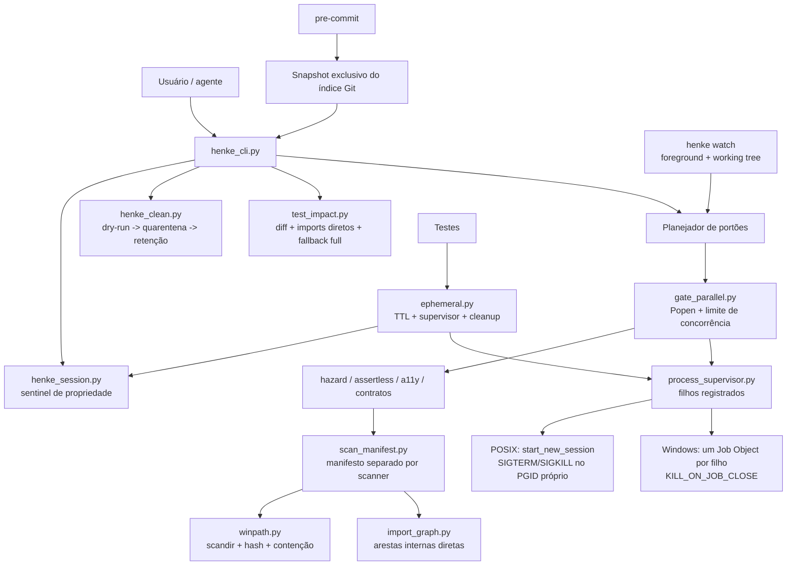
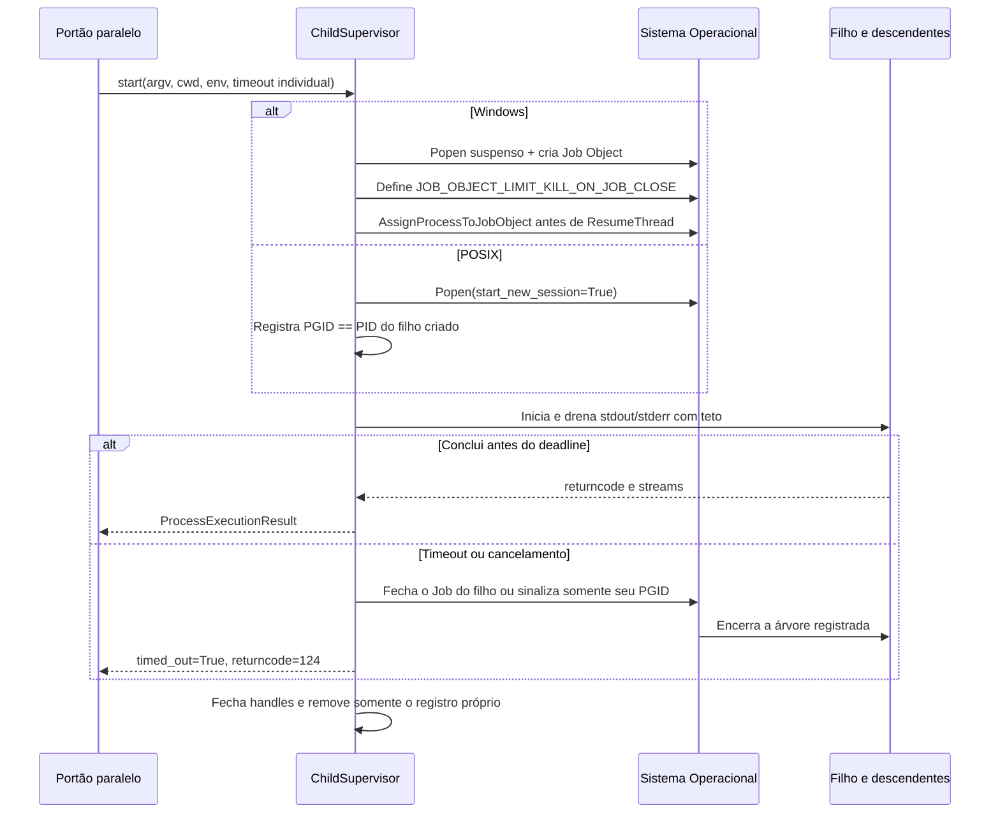
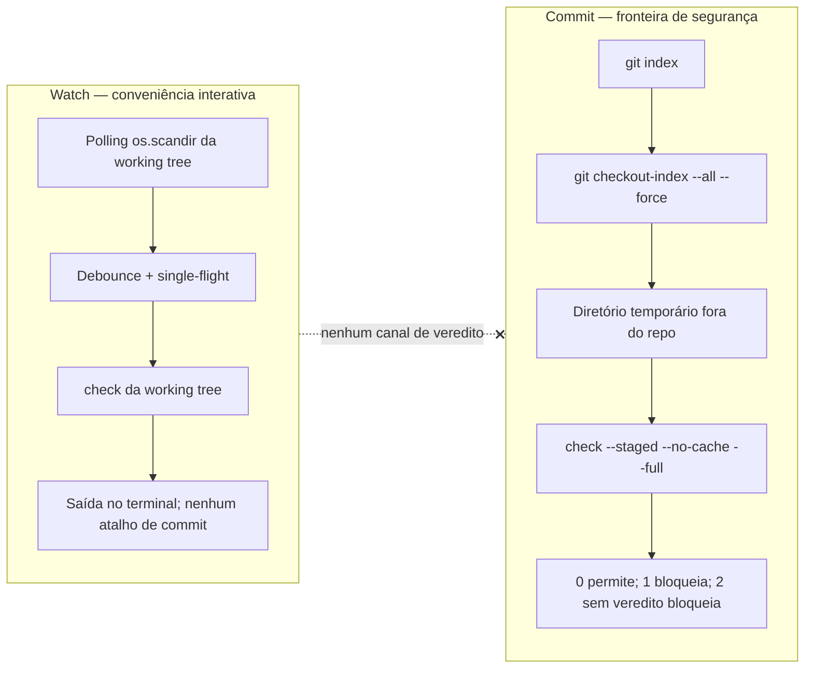
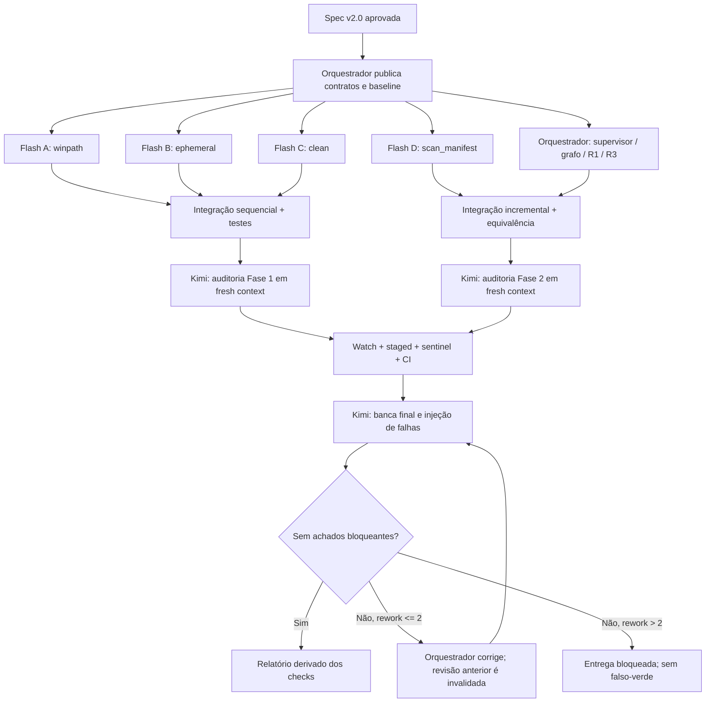

# Wave 7 — Performance & Higiene v2.0: Arquitetura Blindada — Plano de Implementação

> **For agentic workers:** REQUIRED SUB-SKILL: Use `executing-plans` para executar este plano task-by-task, na worktree e com a divisão multiagente definidas aqui. Cada etapa usa checkbox (`- [ ]`) para rastreamento. Nenhum construtor aprova o próprio trabalho.

**Goal:** Reduzir o custo dos ciclos de verificação sem alterar seus vereditos e impedir vazamento de processos, arquivos temporários e dados apagados prematuramente, com Python puro e comportamento seguro no Windows e no Linux.

**Architecture:** A CLI executa portões independentes como subprocessos leves, cada um com timeout, saída limitada e supervisor por propriedade. Um índice conservador de imports e manifestos por scanner evita trabalho redundante; watch é apenas um cliente foreground da working tree, enquanto o pre-commit sempre extrai e verifica o índice Git. Toda higiene de arquivos passa por caminhos canônicos, contenção e quarentena restaurável.

**Tech Stack:** Python 3.11/3.12, stdlib (`subprocess.Popen`, `os.scandir`, `hashlib`, `ast`, `ctypes`, `threading`, `tempfile`, `unittest`), Git, Win32 Job Objects via `ctypes`, process groups POSIX, GitHub Actions Ubuntu/Windows. Nenhuma dependência nova.

---

## Controle documental

| Campo | Valor |
|---|---|
| Versão | **2.0 — Arquitetura Blindada** |
| Data de redação | 2026-11-09 |
| Estado editorial | Definitivo |
| Estado operacional | `PLANEJAR`; a fase `EXECUTAR` exige aprovação explícita da spec copiada para a worktree |
| Documento substituído | `wave7_plano_performance_e_higiene.md` |
| Repositório raiz intocado | `F:\DEV\ACTIVE\henke-skills` |
| Worktree de implementação | `F:\DEV\ACTIVE\henke-skills-w7` |
| Branch | `feat/wave7-perf-higiene` |
| Base obrigatória | `feat/wave6-expansoes`, commit `36cb454dd9ef05a08a9f77545de82252ead9659b` |
| Situação física observada na redação | A worktree já existe, está limpa, na branch correta e exatamente em `36cb454` |
| Orquestrador | Devin SWE-2 Max |
| Construtores | Instâncias `swe-2-flash-max`, com arquivos disjuntos |
| Auditor adversarial | Kimi K3.1 Pro Max, em contexto limpo, sem editar o código auditado |

**Regra de custódia:** não recriar, reparar, limpar ou fazer reset da worktree existente. Se ela estiver suja ou fora da base no início da execução, parar e pedir decisão humana. Nenhum comando de implementação, teste, limpeza ou commit deve ter `F:\DEV\ACTIVE\henke-skills` como `cwd` ou `--repo`.

---

## 1. Contexto & Problema

A versão anterior misturava metas úteis com complexidade e riscos operacionais: pool de processos pesado, daemon residente, extensão Rust, seleção de testes baseada em cobertura persistente, atalho de veredito do watch no commit, varredura global de processos e remoção direta de arquivos. Essas escolhas aumentavam a superfície de falha justamente nos caminhos que deveriam ser mais confiáveis.

A Wave 6 já oferece pontos de partida reais:

- `scripts/henke_cli.py` possui `check`, `--staged`, cache e hook nativo.
- `scripts/process_runner.py` encapsula `Popen`, mas ainda usa `taskkill /F /T /PID` e fallback POSIX baseado no grupo obtido em runtime.
- `scripts/install_hook.py` chama `check --staged --no-cache`.
- `scripts/gate_cache.py` e os scanners ainda fazem caminhos e varreduras que precisam ser integrados sem duplicar motores.
- `.github/workflows/ci.yml` já possui a matriz Ubuntu/Windows × Python 3.11/3.12.
- `requirements.txt` contém somente a dependência já existente `PyYAML>=6.0,<7`; a Wave 7 não altera esse arquivo.

Os números de tempo, memória e disco do plano anterior são **históricos e não são metas comprovadas desta versão**. Toda afirmação de melhoria de performance deverá nascer de medições antes/depois registradas por `henke exec`.

### 1.1 Resultados exigidos

1. Portões independentes executam em paralelo limitado, com timeout individual e encerramento completo da árvore do subprocesso que expirou.
2. Testes são selecionados por arquivo somente quando o grafo direto de imports e o diff provam que a seleção é segura; incerteza executa a suíte inteira.
3. Scanners elegíveis reutilizam achados por arquivo somente quando conteúdo, dependências, configuração, argumentos e versão do scanner permanecem válidos.
4. `henke watch` é interativo, foreground e isolado do commit.
5. Todo commit avalia o snapshot do índice Git, inclusive quando a working tree diverge do stage.
6. Processos são encerrados somente por handles de filhos criados e registrados pelo próprio supervisor.
7. `henke clean` move itens elegíveis para quarentena e só permite deleção permanente após retenção e confirmação humana específica.
8. Caminhos longos, nomes reservados e reparse points/junctions não atravessam as proteções de disco.
9. CI conserva e exercita a matriz 2×2, com testes Win32 físicos no Windows e fallbacks reais no Ubuntu.

### 1.2 Não objetivos e cortes definitivos

| Item | Decisão | Consequência obrigatória |
|---|---|---|
| R2 — Daemon residente | **CANCELADO** | Não criar daemon, named pipe, PID file, serviço, cliente ou comando `henke daemon`. |
| R4 — Rust/PyO3 | **CANCELADO** | Não criar `native/`, `Cargo.toml`, `build.rs`, bindings ou fallback nativo; não alterar lockfiles nem `requirements.txt`. |
| Ceifador global `henke reap` | **CANCELADO** | Não enumerar nem matar processos por nome, idade, PPID, ociosidade ou suposto estado zumbi. |
| Cache de veredito do watch no pre-commit | **PROIBIDO** | O hook não consulta estado, resultado, socket ou atalho do watch. |
| Limpeza genérica de caches de outros agentes | **FORA DO ESCOPO** | Não varrer `~/.kiro`, `~/.gemini`, `~/.devin` nem diretórios arbitrários do usuário. |
| Seleção incremental para gates globais | **FORA DO ESCOPO** | `contract_closure`, `spec_drift`, `metaconfig`, cobertura, ledger e mutação continuam integrais. |

---

## 2. Decisões Técnicas & Arquitetura

### 2.1 Visão de componentes



### 2.2 Fluxo de vida de um subprocesso



### 2.3 Separação absoluta entre watch e commit



### 2.4 Invariantes não negociáveis

1. **Propriedade:** só se encerra um processo por um handle devolvido por `ChildSupervisor.start` na mesma execução. Sentinel, PID serializado e nome de executável não são autoridade de morte.
2. **Conteúdo, não relógio:** cache e seleção dependem de hashes e grafos; timestamps servem apenas para auditoria humana.
3. **Falha fecha:** erro de snapshot, scanner, grafo, hash, lock ou supervisor resulta em suíte completa quando isso for seguro, ou em `exit 2` quando não houver veredito confiável. Nunca resulta em verde presumido.
4. **Sem escrita concorrente compartilhada:** cada scanner possui manifesto e lock próprios; cada execução de teste usa estado temporário próprio.
5. **Determinismo de saída:** resultados são apresentados na ordem declarativa dos portões, não na ordem de término.
6. **Sem daemon oculto:** fechar o terminal encerra o watch e seus filhos supervisionados.
7. **Sem deleção ambígua:** `--execute` no modo normal de `clean` significa **mover para quarentena**, não apagar definitivamente.
8. **CI integral:** pull requests e a validação final sempre executam a suíte completa e os portões globais, independentemente de R3/R5.
9. **Escopo cirúrgico:** nenhuma mudança em comportamento de scanners, regras de segurança ou formato de findings além do necessário para adaptá-los ao incremental.
10. **Auditoria independente:** correção invalida a revisão anterior; no máximo duas rodadas de retrabalho (`MAX_REWORK = 2`).

---

## 3. Contratos de Tipos, Entrada & Saída

### 3.1 Convenções compartilhadas

- Caminhos de findings, dependências e escopo persistidos são relativos ao repo, separados por `/`, normalizados sem `..`, absolutos ou componentes reservados. A única exceção é `original_path` no manifesto de quarentena, que conserva o caminho absoluto canônico necessário para restore e a raiz permitida correspondente.
- JSON é UTF-8, `ensure_ascii=False`, chaves ordenadas quando usado em hash, schema versionado e escrita via arquivo temporário no mesmo diretório + `flush` + `os.fsync` + `os.replace`.
- Nenhum módulo novo usa `shell=True`.
- `HENKE_STATE_DIR`, quando definido como caminho absoluto, redireciona `.henke` para auditoria e testes. Sem ele, o estado fica em `<repo>/.henke`.
- Saída pública de comandos: `0` = sucesso; `1` = veredito negativo ou falha operacional de uma ação solicitada; `2` = uso inválido, ambiente inconsistente ou ausência de veredito confiável.
- Dentro de `GateResult`, `124` = timeout e `125` = supervisor indisponível; o agregador converte qualquer um deles em falha e jamais em cache verde.
- Todos os módulos usam `sys.platform == "win32"` como guarda canônica de Win32. `startswith("win")` pode permanecer apenas em código legado não tocado.

`scripts/state_paths.py`:

```python
from pathlib import Path
import os


def state_dir(repo_root: Path) -> Path:
    override = os.environ.get("HENKE_STATE_DIR")
    if override:
        path = Path(override)
        if not path.is_absolute():
            raise ValueError("HENKE_STATE_DIR deve ser absoluto")
        return path
    return repo_root.resolve() / ".henke"
```

### 3.2 R7 — `scripts/winpath.py`

```python
from dataclasses import dataclass
from pathlib import Path, PurePath
from typing import Iterator, Literal


class PathSafetyError(ValueError):
    pass


class UnstableFileError(OSError):
    pass


@dataclass(frozen=True)
class TreeEntry:
    path: Path
    relative_path: str
    kind: Literal["file", "directory", "skipped", "error"]
    size: int
    mtime_ns: int
    reason: str = ""


@dataclass(frozen=True)
class FileDigest:
    sha256: str
    size: int
    mtime_ns: int


def canonical_path(path: Path | str, *, base: Path | None = None,
                   extended: bool = True) -> Path: ...
def is_reserved_component(name: str) -> bool: ...
def assert_safe_relative(path: PurePath | str) -> str: ...
def is_within(root: Path, candidate: Path) -> bool: ...
def iter_tree(root: Path, *, prune_names: frozenset[str] = frozenset(),
              max_depth: int = 64) -> Iterator[TreeEntry]: ...
def sha256_file(path: Path, *, chunk_size: int = 1024 * 1024) -> FileDigest: ...
```

**Contrato de `canonical_path`:**

1. Resolve `base / path` sem exigir existência, usando normalização lexical (`abspath` + `normpath`) em vez de `Path.resolve()` sobre alvo não confiável; nenhum symlink, junction ou último reparse point é seguido.
2. No Windows, produz caminho absoluto idempotente: `C:\...` pode virar `\\?\C:\...`; `\\server\share\...` vira `\\?\UNC\server\share\...`; um prefixo `\\?\` existente não é duplicado.
3. Rejeita o namespace de dispositivo `\\.\`, caminhos relativos sem `base`, componentes `..` em APIs que exigem contenção e nomes reservados para escrita.
4. A normalização para comparação usa `os.path.normcase`; a apresentação preserva Unicode.
5. Em POSIX, retorna caminho absoluto normalizado e não aplica prefixos Win32.

**Nomes reservados:** comparação case-insensitive após remover espaços e pontos finais e considerar o texto antes do primeiro ponto: `CON`, `PRN`, `AUX`, `NUL`, `COM1`…`COM9`, `LPT1`…`LPT9`. Assim, `nul`, `con.txt` e `aux ` são recusados para criação/movimentação.

**Contrato de `iter_tree`:**

- Usa somente `os.scandir` e uma fila explícita; não usa `Path.rglob` nem `os.walk`.
- Não segue symlinks, junctions ou outros reparse points. Em Windows, detecta `FILE_ATTRIBUTE_REPARSE_POINT` via `DirEntry.stat(follow_symlinks=False)`; em POSIX, usa `DirEntry.is_symlink()`.
- Como reparse directories não são seguidos, ciclos de junction terminam em entrada `skipped`, não em recursão. `max_depth` é defesa adicional.
- Erros de permissão, desaparecimento e leitura são emitidos como `TreeEntry(kind="error")`; consumidores de segurança tratam qualquer erro como `exit 2`, não como ausência de arquivo.
- A ordem é determinística: entradas de cada diretório são ordenadas por `name.casefold()` e depois `name`.

**Contrato de `sha256_file`:** lê em blocos com `hashlib.sha256`, compara `(size, mtime_ns)` antes/depois e lança `UnstableFileError` se o arquivo mudou durante a leitura. Não segue reparse point e não retorna hash parcial.

### 3.3 R7/R1 — `scripts/process_supervisor.py` e fachada `process_runner.py`

```python
from dataclasses import dataclass
from pathlib import Path
from typing import Mapping, Sequence


@dataclass(frozen=True)
class ProcessExecutionResult:
    returncode: int
    stdout: str
    stderr: str
    timed_out: bool
    killed_tree: bool
    duration_ms: int
    stdout_sha256: str
    stderr_sha256: str
    output_truncated: bool
    termination_reason: str


class ChildSupervisor:
    def start(self, argv: Sequence[str], *, cwd: Path,
              env: Mapping[str, str] | None = None,
              max_output_bytes: int = 1024 * 1024) -> "ChildHandle": ...
    def wait(self, child: "ChildHandle", *,
             timeout_sec: float) -> ProcessExecutionResult: ...
    def terminate(self, child: "ChildHandle", *, reason: str) -> None: ...
    def close(self) -> None: ...
```

`ChildHandle` é opaco e pertence a uma única instância de `ChildSupervisor`. Passar o handle a outro supervisor, usar um handle já fechado ou chamar `wait` duas vezes gera erro explícito.

**Windows:**

1. Cria um Job Object por filho, com `JOB_OBJECT_LIMIT_KILL_ON_JOB_CLOSE` (`0x2000`).
2. Cria o filho com `subprocess.Popen`, `shell=False` e `CREATE_SUSPENDED`; associa o processo ao Job antes de liberar sua thread principal.
3. Usa `CreateToolhelp32Snapshot`/`OpenThread`/`ResumeThread` para liberar somente a thread do processo recém-criado. Handles Win32 têm `argtypes`/`restype` definidos, são não herdáveis e são fechados em `finally`; `Popen` usa `close_fds=True` para que filhos não retenham o Job Handle.
4. Se a associação ao Job falhar, encerra o processo ainda suspenso pelo handle criado, fecha os handles e retorna `SUPERVISOR_UNAVAILABLE`; nunca executa um filho não supervisionado.
5. Timeout/cancelamento fecha o Job daquele filho. Não chama `taskkill`, não consulta `tasklist` e não encerra PIDs recuperados de disco.

**POSIX:**

1. Usa `start_new_session=True`; o PGID esperado é exatamente o PID do filho criado.
2. Timeout envia `SIGTERM` ao grupo próprio, aguarda uma graça curta e envia `SIGKILL` se necessário.
3. Não usa o grupo do processo pai e não chama `os.getpgid` sobre um PID não registrado.

**Streams:** threads apenas drenam `stdout`/`stderr`; processos continuam sendo criados por `Popen`, sem executor. Cada stream é drenado até EOF, mas somente os primeiros `max_output_bytes` são retidos; o restante entra no hash e é descartado. `output_truncated=True` deixa o corte explícito.

`run_process(...)` permanece como fachada compatível da Wave 6, delegando a um supervisor de um único filho. A função pública `kill_process_tree(pid)` deixa de existir: morte por PID arbitrário não faz mais parte da API.

### 3.4 R1 — `scripts/gate_parallel.py`

```python
@dataclass(frozen=True)
class GateSpec:
    name: str
    argv: tuple[str, ...]
    cwd: Path
    timeout_sec: float = 120.0


@dataclass(frozen=True)
class GateResult:
    name: str
    exit_code: int
    stdout: str
    stderr: str
    passed: bool
    cached: bool
    timed_out: bool
    duration_ms: int
    output_truncated: bool
    output_error: bool


def run_gates_parallel(specs: Sequence[GateSpec], *,
                       max_parallel: int = 4) -> list[GateResult]: ...
```

- `1 <= max_parallel <= 4`; o padrão real é `min(4, len(specs))`.
- O deadline começa quando cada filho é iniciado. Um timeout fecha somente o Job/PGID daquele portão; os demais continuam até concluir ou atingir seus próprios deadlines.
- Falha de um portão não cancela os demais, para reunir todos os achados.
- O retorno preserva a ordem de `specs`. JSON e texto usam essa mesma ordem.
- `passed = exit_code == 0 and not timed_out and not output_error`.
- O agregador retorna `2` se qualquer resultado tiver `output_error`, `exit_code == 2` ou `exit_code == 125`; caso contrário retorna `1` se houver timeout (`124`) ou outro código não zero; retorna `0` somente quando todos passam.
- Não importa nem usa `ProcessPoolExecutor`, `ThreadPoolExecutor`, `multiprocessing` ou `asyncio` para criar portões.

CLI:

```text
henke check --repo <path> [--spec <repo-relative-md>] [--staged]
            [--full] [--jobs 1..4] [--gate-timeout SEGUNDOS]
            [--json] [--no-cache] [--state-dir <absolute-path>]
```

`--staged` implica `--no-cache --full`, desativa watch, manifestos incrementais e cache de vereditos, e usa o diretório exportado como único alvo de leitura dos arquivos.

### 3.5 R3 — `scripts/test_impact.py` por arquivo de teste

```python
@dataclass(frozen=True)
class ImpactSelection:
    mode: Literal["selected", "full"]
    changed_files: tuple[str, ...]
    test_files: tuple[str, ...]
    reasons: tuple[str, ...]
    unresolved_files: tuple[str, ...]


def discover_changed_files(repo_root: Path, base: str) -> tuple[str, ...]: ...
def select_tests(repo_root: Path, base: str,
                 direct: Mapping[str, frozenset[str]]) -> ImpactSelection: ...
def build_unittest_command(selection: ImpactSelection,
                           repo_root: Path) -> list[str]: ...
```

**Fonte do diff:** `git diff --name-only --diff-filter=ACDMRTUXB <base> --`, acrescido de `git ls-files --others --exclude-standard`. Renomes incluem origem e destino; falha do Git retorna `exit 2`. Para CI e pré-merge, `--full` é obrigatório.

**Mapa:** para cada arquivo Python, inclusive cada `tests/**/test_*.py`, registra somente os módulos internos **diretamente importados**. Para cada teste, o fechamento transitivo dessas arestas diretas é calculado em memória; não há `coverage.py`, mapa de cobertura persistente nem inferência por nome de função.

**Seleção conservadora:**

1. Teste alterado é selecionado.
2. Teste é selecionado quando qualquer arquivo alterado pertence ao fechamento de suas dependências diretas; assim, `test_b -> helper_b -> modulo_b` também seleciona `test_b` quando `modulo_b` muda.
3. Se qualquer arquivo Python de produção alterado não pertencer à união dos fechamentos alcançáveis por pelo menos um teste, `mode="full"`; arquivos desconhecidos ou aparentemente não utilizados nunca são tratados como prova de ausência de impacto.
4. `conftest.py`, fixtures compartilhadas, `tests/e2e/e2e_common.py`, configs, lockfiles, workflows, arquivos não-Python, deleções, imports dinâmicos, sintaxe inválida ou imports internos não resolvidos implicam `mode="full"`.
5. Nenhum arquivo alterado produz `selected` com lista vazia e razão `no_changes`; pre-merge/CI ignoram essa otimização via `--full`.
6. O comando usa `[sys.executable, "-m", "unittest", *test_files]` para seleção e `[sys.executable, "-m", "unittest", "discover", "-s", "tests", "-p", "test_*.py"]` para full.

CLI:

```text
henke test-impact --repo <path> --base <git-ref> [--full] [--run] [--json]
```

Sem `--run`, apenas emite a decisão. Com `--run`, executa via `ChildSupervisor` e `henke exec` registra o comando resolvido e os hashes da saída. No caso `no_changes`, retorna `0` sem criar subprocesso e registra a razão, em vez de invocar um runner com lista vazia.

### 3.6 Grafo compartilhado — `scripts/import_graph.py`

```python
@dataclass(frozen=True)
class ImportGraph:
    direct: Mapping[str, frozenset[str]]
    unresolved: Mapping[str, tuple[str, ...]]

    def reverse_closure(self, changed: Iterable[str]) -> frozenset[str]: ...


def build_import_graph(repo_root: Path) -> ImportGraph: ...
```

A construção reutiliza o motor já existente em `repo_signals.py`: extrai `build_dependency_edges(root)` de `cmd_edges`, mantendo `cmd_edges` como adaptador de impressão. O builder retorna arestas e uma lista separada de imports não resolvidos/erros de parse; `cmd_edges` preserva seu JSON atual, enquanto `ImportGraph` consome essas incertezas para fallback. Python usa AST; JS/TS usa `polyglot.find_imports` + `resolve_js`; Rust e Go usam as mesmas regras atuais. Nenhum segundo parser de chaves ou imports será criado.

`reverse_closure(C)` retorna `C` mais todos os arquivos que dependem direta ou transitivamente de `C`. Ciclos são visitados uma única vez. Qualquer import interno não resolvido é registrado e força rebuild integral no consumidor.

### 3.7 R5 — `scripts/metricas/scan_manifest.py`

#### 3.7.1 API e adapters

```python
@dataclass(frozen=True)
class ScannerSpec:
    scanner_id: Literal["hazard", "assertless", "a11y"]
    scanner_version: str
    script_path: Path
    config_paths: tuple[str, ...]


@dataclass(frozen=True)
class IncrementalScanResult:
    scanner_id: str
    exit_code: int
    findings: tuple[dict[str, object], ...]
    scanned_files: tuple[str, ...]
    reused_files: tuple[str, ...]
    invalidated_files: tuple[str, ...]
    full_scan: bool
    reasons: tuple[str, ...]


def run_incremental_scan(repo_root: Path, spec: ScannerSpec, *,
                         full: bool = False) -> IncrementalScanResult: ...
```

- `hazard` usa `hazard_scan.scan_file`; `_check_env_committed` permanece uma checagem global executada em toda invocação e nunca é cacheada.
- `assertless` exige extrair de `run()` uma função pura `scan_test_file(path, helpers) -> (scanned_count, findings)`; opções `--assert-helper` entram no fingerprint.
- `a11y` usa `scan_a11y_file` já existente.
- Cada entrada possui `status: scanned | skipped_oversize`; skips preservam a mesma contagem e o mesmo diagnóstico do caminho integral. Erros de leitura/parse não são cacheados como findings vazios e produzem `exit 2`. Um código auxiliar de “nenhum teste encontrado” vira ausência de veredito no agregador, nunca sucesso.
- O `scanner_version` é uma constante explícita do adapter. O SHA-256 real do script também participa do fingerprint; portanto, mudança de código invalida mesmo se alguém esquecer o bump textual. Um `engine_sha256` agrega, em ordem de caminho, os hashes de `scan_manifest.py`, `import_graph.py`, `repo_signals.py`, `polyglot.py`, `winpath.py` e do scanner, invalidando também mudanças no motor ou no resolvedor.
- Cada adapter declara suas configurações e argumentos. `fixtures_manifest`, suppressions externas e helpers declarados entram no hash de configuração.
- Demais portões não recebem adapter nesta Wave.

#### 3.7.2 Local e schema

Cada scanner grava `<state_dir>/scan-manifests/<scanner_id>.json`; não existe manifesto global compartilhado.

```json
{
  "schema_version": 1,
  "scanner": {
    "id": "hazard",
    "version": "wave7.1",
    "script_sha256": "aaaaaaaaaaaaaaaaaaaaaaaaaaaaaaaaaaaaaaaaaaaaaaaaaaaaaaaaaaaaaaaa",
    "engine_sha256": "eeeeeeeeeeeeeeeeeeeeeeeeeeeeeeeeeeeeeeeeeeeeeeeeeeeeeeeeeeeeeeee",
    "python": "3.11",
    "args_sha256": "bbbbbbbbbbbbbbbbbbbbbbbbbbbbbbbbbbbbbbbbbbbbbbbbbbbbbbbbbbbbbbbb",
    "config_sha256": "cccccccccccccccccccccccccccccccccccccccccccccccccccccccccccccccc",
    "graph_version": 1
  },
  "files": {
    "scripts/example.py": {
      "sha256": "dddddddddddddddddddddddddddddddddddddddddddddddddddddddddddddddd",
      "size": 1200,
      "mtime_ns": 1794352800000000000,
      "status": "scanned",
      "dependencies": ["scripts/helper.py"],
      "findings": []
    }
  }
}
```

#### 3.7.3 Algoritmo transacional

1. Adquirir lock não bloqueante do scanner (`msvcrt.locking` no Windows, `fcntl.flock` no POSIX). Lock ocupado gera razão `manifest_locked` e execução integral **sem gravar** o manifesto, ou `exit 2` se o modo integral também não puder produzir veredito.
2. Enumerar com `winpath.iter_tree`, calcular hashes estáveis e construir o grafo. Erro de enumeração/hash, import não resolvido ou arquivo mutável produz `SNAPSHOT_UNSTABLE` e `exit 2`.
3. Validar `schema_version`, scanner/version/script hash, `engine_sha256`, Python major.minor, argumentos, configs e `graph_version`. Divergência ou JSON inválido implica full rebuild.
4. `changed = novos + hash divergente + removidos`.
5. `dirty = reverse_closure(changed)`; dependências removidas usam as arestas do manifesto anterior unidas às do grafo atual.
6. Escanear somente arquivos existentes em `dirty`; reutilizar findings dos demais. Arquivos removidos têm entradas e achados eliminados.
7. Executar as checagens globais do adapter em toda rodada.
8. Se qualquer scan falhar, não alterar o manifesto anterior e retornar falha. Se todos terminarem, gravar uma única nova versão atomicamente e liberar o lock.
9. Veredito final deriva da união ordenada de findings reutilizados, novos e globais. Não se persiste um campo `passed` global.

#### 3.7.4 Propriedades de correção

- Mudança em dependência invalida os dependentes reversos, não apenas o arquivo editado.
- Remover um arquivo remove seus findings antigos e invalida seus dependentes.
- Uma falha parcial nunca apaga findings anteriores nem transforma scan incompleto em verde.
- Manifesto corrompido ou truncado não é “cache vazio com zero findings”: é rebuild integral registrado.
- `--full` executa tudo e regrava o manifesto somente após sucesso; `--staged` nem lê nem grava manifesto.

### 3.8 R6 — `scripts/henke_watch.py`

```python
@dataclass(frozen=True)
class WatchConfig:
    repo_root: Path
    poll_interval_sec: float = 0.75
    debounce_sec: float = 0.30
    quiet: bool = False


class WatchController:
    def snapshot_signature(self) -> str: ...
    def run_once(self) -> int: ...
    def run_foreground(self) -> int: ...
```

- Exige `sys.stdin.isatty()` e `sys.stdout.isatty()` no comando CLI. Testes chamam `run_once` diretamente; não há flag para fingir daemon.
- Polling com `os.scandir` por `winpath.iter_tree`, excluindo `.git`, `.henke`, o `HENKE_STATE_DIR`, quarentena, caches e diretórios de dependências. Assim, o próprio relatório não dispara novo ciclo.
- A assinatura combina caminho + hash de conteúdo dos arquivos elegíveis; mtime sozinho não confirma mudança.
- Debounce coalesce uma rajada em uma execução. `single-flight` impede overlap; mudanças durante um check ficam pendentes para exatamente um próximo ciclo.
- `Ctrl+C` fecha o supervisor, aguarda os filhos próprios e retorna `130`.
- `--quiet` suprime apenas repetições verdes idênticas; transições e falhas continuam visíveis.
- Não há `start`, `stop`, `status`, PID file, socket, named pipe, serviço, thread sobrevivente ou escrita de veredito reutilizável pelo hook.

CLI: `henke watch --repo <path> [--quiet] [--poll-interval 0.75] [--debounce 0.30]`.

### 3.9 R7 — `scripts/henke_clean.py` com quarentena

```python
@dataclass(frozen=True)
class CleanCandidate:
    source: Path
    kind: Literal["repo-cache", "ephemeral-expired"]
    size_bytes: int


@dataclass(frozen=True)
class QuarantineBatch:
    batch_id: str
    created_at: str
    expires_at: str
    items: tuple[dict[str, object], ...]


def plan_clean(repo_root: Path) -> tuple[CleanCandidate, ...]: ...
def quarantine(repo_root: Path, candidates: Sequence[CleanCandidate],
               *, retention_days: int = 7) -> QuarantineBatch: ...
def restore_batch(repo_root: Path, batch_id: str) -> int: ...
def purge_expired_batch(repo_root: Path, batch_id: str,
                        *, now: datetime) -> int: ...
```

**Alvos permitidos:** caches dentro do repo (`__pycache__`, `.pytest_cache`, `.mypy_cache`, `.henke/cache`) e workspaces efêmeros expirados que possuam marker e registro Henke válidos. Não há padrões globais em `%TEMP%`, home, `dist`, `build`, `node_modules` ou dados de conversas.

**Comandos:**

```text
henke clean --repo <path>                              # dry-run, zero mutações
henke clean --repo <path> --execute                    # move para quarentena
henke clean --repo <path> --restore <batch-id> --execute
henke clean --repo <path> --purge-expired --execute --confirm-batch <batch-id>
```

**Quarentena:** `<state_dir>/quarantine/<batch-id>/`, com `manifest.json` e payload. Cada item registra `original_path` absoluto canônico, a raiz permitida (`repo` ou raiz efêmera validada), caminho relativo àquela raiz, destino, tipo, tamanho, SHA-256 agregado, `created_at` e `expires_at = created_at + 7 dias`. `retention_days < 1` é inválido.

1. Dry-run não cria nem remove diretórios.
2. A movimentação valida contenção na raiz permitida, ausência de reparse points e nomes seguros antes de escrever.
3. Na mesma unidade, usa rename para staging e depois para o destino final. Entre unidades, copia para staging, verifica hashes, faz rename e só então remove a origem elegível.
4. Falha parcial mantém manifesto de cada item concluído e permite restore; nenhum item é dado como movido antes da verificação.
5. A quarentena é excluída de futuras varreduras e de watch.
6. Restore exige destino ausente, caminho original ainda contido na mesma raiz permitida e hash igual ao manifesto.
7. Purga exige `now >= expires_at`, ID exato de um único batch e confirmação humana daquele comando. Não existe `--all`, purga por idade de arquivo ou purga automática em `check`, `watch`, hook, `session gc` ou `atexit`.
8. Staging remanescente de crash é reportado no dry-run e só pode ser restaurado à origem após validação de marker e hash; staging desconhecido permanece intocado e nunca é purgado automaticamente.

Logs ficam em `<state_dir>/clean_log.jsonl`, incluindo ação, batch, item, hash e resultado; segredos e conteúdo de arquivos nunca são registrados.

### 3.10 R7 — `scripts/ephemeral.py`

```python
@dataclass(frozen=True)
class EphemeralConfig:
    ttl_seconds: float = 300.0
    session_id: str | None = None


class EphemeralWorkspace:
    @property
    def path(self) -> Path: ...
    def path_for(self, relative: str) -> Path: ...
    def write_bytes(self, relative: str, data: bytes) -> Path: ...
    def write_text(self, relative: str, text: str) -> Path: ...
    def run(self, argv: Sequence[str], *, timeout_sec: float | None = None,
            env: Mapping[str, str] | None = None) -> ProcessExecutionResult: ...
    def close(self) -> None: ...


def ephemeral_workspace(config: EphemeralConfig | None = None,
                        *, repo_root: Path) -> ContextManager[EphemeralWorkspace]: ...
def ephemeral_test(*, ttl_seconds: float = 120.0) -> Callable: ...
def ephemeral_gc(repo_root: Path, *, now: datetime) -> int: ...
```

- Cria diretório único no temp do sistema, prefixo `henke-eph-<session>-<uuid>`, com marker `.henke-ephemeral.json` contendo UUID, session, repo e `expires_at`.
- `path_for`, escrita e cleanup exigem caminho relativo seguro e contido. Não se escreve fora do workspace.
- Todo `run` usa o `ChildSupervisor` da workspace. O timeout efetivo é `min(timeout_sec, tempo_restante_do_TTL)`.
- Um `threading.Timer` é apenas o gatilho em processo vivo; o Job Object é a garantia de morte dos filhos quando os handles são fechados, inclusive por término abrupto do interpretador.
- `close()` é idempotente: cancela timer, fecha supervisor, espera os filhos próprios e remove somente o diretório com marker e UUID correspondentes. Exceção do teste continua propagando após cleanup.
- Se o interpretador cair, o SO mata os filhos ao fechar os Jobs; o diretório remanescente só é removido por `ephemeral_gc` após expiração e validação do marker. Não se confia em PID para limpar ou matar.
- `@ephemeral_test` injeta `ws` por keyword, preserva assinatura com `functools.wraps` e sempre executa `close()` em `finally`.

### 3.11 R7 — `scripts/henke_session.py` e sentinel em `AGENTS.md`

```python
@dataclass(frozen=True)
class SessionSentinel:
    schema_version: int
    session_id: str
    run_id: str
    agent: str
    workspace: str
    owner_pid: int
    started_at: str
    heartbeat_at: str
    heartbeat_expires_at: str
    state: Literal["active", "closed", "reaped"]
    ephemeral_workspaces: tuple[str, ...]


def start_session(agent: str, workspace: Path, run_id: str) -> SessionSentinel: ...
def register_ephemeral(session_id: str, workspace: Path) -> None: ...
def heartbeat(session_id: str) -> None: ...
def end_session(session_id: str) -> None: ...
def session_gc(workspace: Path, *, now: datetime) -> int: ...
```

O sentinel fica em `<state_dir>/sessions/<session-id>.sentinel.json`. `owner_pid` é informativo para diagnóstico; nunca autoriza morte, inclusive para evitar PID reuse. O registro de workspace exige marker efêmero válido e contenção. `start_session` define `heartbeat_expires_at = started_at + 1 hora` e cada `heartbeat` renova essa janela. `session_gc` só marca como `reaped` um sentinel `active` cuja janela expirou e chama somente `ephemeral_gc`, que ainda exige a expiração individual de cada workspace; não varre processos, não apaga caminhos arbitrários e não remove workspace efêmera dentro do TTL.

Bloco exato a acrescentar em `AGENTS.md`:

```markdown
## 5. Protocolo de Sessão com Sentinel (Obrigatório em EXECUTAR)

1. Inicie com `henke session start --agent <nome> --workspace <worktree> --run-id <id>` e exporte o `HENKE_SESSION_ID` impresso.
2. Crie arquivos temporários e filhos somente por `ephemeral_workspace(...)`/`ws.run(...)` ou por `henke exec`; não registre PIDs manualmente.
3. Execute `henke session heartbeat <session-id>` após cada fase e `henke session end <session-id>` em `finally` antes do relatório final.
4. Em retomada ou nova sessão, execute `henke session gc --workspace <worktree>`. O sentinel não é autoridade para matar PID nem apagar caminho arbitrário.
5. O relatório final deve informar o estado do sentinel e a seção "O que NÃO foi verificado".
```

---

## 4. Escopo Declarado (Arquivos e Símbolos a Tocar)

> Na transição para `EXECUTAR`, este documento será copiado, sem mudança de escopo, para `docs/designs/wave7-performance-higiene-v2.md` na worktree. O hash dessa cópia será aprovado antes do primeiro commit de código.

### 4.1 Arquivos novos

- `docs/designs/wave7-performance-higiene-v2.md`
- `scripts/state_paths.py`
- `scripts/winpath.py`
- `scripts/process_supervisor.py`
- `scripts/gate_parallel.py`
- `scripts/import_graph.py`
- `scripts/test_impact.py`
- `scripts/metricas/scan_manifest.py`
- `scripts/henke_watch.py`
- `scripts/henke_clean.py`
- `scripts/ephemeral.py`
- `scripts/henke_session.py`
- `tests/test_state_paths.py`
- `tests/test_winpath.py`
- `tests/test_process_supervisor.py`
- `tests/test_gate_parallel.py`
- `tests/test_import_graph.py`
- `tests/test_impact.py`
- `tests/test_scan_manifest.py`
- `tests/test_henke_watch.py`
- `tests/test_henke_clean.py`
- `tests/test_ephemeral.py`
- `tests/test_henke_session.py`
- `tests/test_wave7_integration.py`
- `evals/bench_wave7.py`
- `evals/canaries_wave7.py`

### 4.2 Arquivos existentes modificados

- `AGENTS.md` — somente o Protocolo de Sessão com sentinel.
- `.gitignore` — manifests locais, quarentena, sessões e estado efêmero; sem ignorar a spec.
- `.github/workflows/ci.yml` — execução dos novos testes/canários na matriz já existente.
- `scripts/henke_cli.py` — wiring dos comandos, planejador paralelo, staged estrito e flags.
- `scripts/process_runner.py` — fachada compatível sobre o supervisor; remoção da morte pública por PID.
- `scripts/repo_signals.py` — extração pura de build_dependency_edges, sem mudar o JSON de edges.
- `scripts/gate_cache.py` — uso de state_dir e desativação total no staged; sem redesenho do cache.
- `scripts/install_hook.py` — chamada staged/full/no-cache e preservação dos hooks legados.
- `scripts/metricas/assertless_scan.py` — extração pura de scan_test_file, mantendo run() equivalente.
- `scripts/metricas/hazard_scan.py` — exposição do adapter global/per-file sem alterar regras.
- `scripts/metricas/a11y_scan.py` — assinatura de adapter e versionamento, sem alterar regras.
- `tests/test_process_runner.py` — compatibilidade da fachada e novos testes de propriedade.
- `tests/test_install_hook.py` — testes bilaterais de stage parcial e ausência de watch.
- `tests/test_metric_gates.py` — compatibilidade dos três scanners após extração dos adapters.

### 4.3 Propriedade por agente

| Agente | Arquivos exclusivos durante construção | Arquivos que não pode editar |
|---|---|---|
| Flash A (`swe-2-flash-max`) | `scripts/winpath.py`, `tests/test_winpath.py` | Todos os demais |
| Flash B (`swe-2-flash-max`) | `scripts/ephemeral.py`, `tests/test_ephemeral.py` | Supervisor, CLI, estado e demais módulos |
| Flash C (`swe-2-flash-max`) | `scripts/henke_clean.py`, `tests/test_henke_clean.py` | Winpath, CLI, `.gitignore`, quarentena real do usuário |
| Flash D (`swe-2-flash-max`) | `scripts/metricas/scan_manifest.py`, `tests/test_scan_manifest.py` | Scanners existentes, grafo, CLI e demais módulos |
| Devin SWE-2 Max | Demais arquivos declarados e integração | Não edita os oito arquivos exclusivos enquanto os flashes trabalham |
| Kimi K3.1 Pro Max | Nenhum; relatórios e ledgers somente em `$TEMP` | Todo o código e a spec auditados |

Runtime paralelo usa `HENKE_STATE_DIR=<diretório-temporário-do-construtor>`. Construtores não fazem commit concorrente, não executam `clean --execute` fora de fixtures e não alteram o índice Git. O orquestrador integra e commita sequencialmente após cada pacote.

---

## 5. Pontes de Contrato

- ponte: `scripts/state_paths.py::state_dir -> tests/test_state_paths.py`
- ponte: `scripts/winpath.py::canonical_path -> tests/test_winpath.py`
- ponte: `scripts/winpath.py::iter_tree -> tests/test_winpath.py`
- ponte: `scripts/winpath.py::sha256_file -> tests/test_winpath.py`
- ponte: `scripts/process_supervisor.py::ChildSupervisor -> tests/test_process_supervisor.py`
- ponte: `scripts/process_runner.py::run_process -> tests/test_process_runner.py`
- ponte: `scripts/gate_parallel.py::run_gates_parallel -> tests/test_gate_parallel.py`
- ponte: `scripts/import_graph.py::build_import_graph -> tests/test_import_graph.py`
- ponte: `scripts/test_impact.py::select_tests -> tests/test_impact.py`
- ponte: `scripts/metricas/scan_manifest.py::run_incremental_scan -> tests/test_scan_manifest.py`
- ponte: `scripts/henke_watch.py::WatchController -> tests/test_henke_watch.py`
- ponte: `scripts/henke_clean.py::quarantine -> tests/test_henke_clean.py`
- ponte: `scripts/henke_clean.py::restore_batch -> tests/test_henke_clean.py`
- ponte: `scripts/ephemeral.py::ephemeral_workspace -> tests/test_ephemeral.py`
- ponte: `scripts/ephemeral.py::ephemeral_test -> tests/test_ephemeral.py`
- ponte: `scripts/henke_session.py::start_session -> tests/test_henke_session.py`
- ponte: `scripts/henke_session.py::session_gc -> tests/test_henke_session.py`
- ponte: `scripts/install_hook.py::install_hook -> tests/test_install_hook.py`
- ponte: `scripts/henke_cli.py::main -> tests/test_wave7_integration.py`

## 6. Casos de Borda & Matriz Pré-Mortem de 40 Anos (Estadista)

| Horizonte | Falha evitada | Controle mecânico | Prova adversarial |
|---|---|---|---|
| Queda de energia / crash parcial | Manifesto ou quarentena finge operação completa | Escrita atômica, staging, hash antes/depois, sentinel sem autoridade de morte | Interromper entre staging e rename; manifesto anterior permanece válido e restore não sobrescreve destino |
| Escala 100x / efeito tornado | Pipes bloqueiam, saída consome RAM, watch dispara tempestade | Máximo 4 filhos, dreno com teto, debounce, single-flight, `os.scandir` com poda | Filho emite mais de 1 MiB e outro dorme; todos os resultados chegam, truncamento fica explícito |
| Direção de dependência | Watch/UI controla supervisor ou scanner importa apresentação | Executores independentes de CLI; CLI só chama APIs; `fence_check` no diff | Grafo não contém aresta de `scripts/metricas` para `henke_watch` ou `henke_cli` |
| Evolução & migração de estado | Scanner novo reutiliza findings antigos | `schema_version`, `scanner_version`, script SHA-256, args/config/graph fingerprints | Alterar um byte do scanner ou helper invalida todos os arquivos |
| Fronteira de falsificabilidade | Falso-verde por cache, seleção, stage ou exceção | Fallback full, snapshot instável = 2, resultados com findings reais, testes bilaterais | Cada otimização possui um caso que prova o caminho permitido e outro que força full/bloqueio |
| PID reuse | Processo alheio morre por sentinel antigo | Handles vivos apenas; `owner_pid` nunca é usado para matar | Sentinel com PID reciclado termina sem sinal para o processo correspondente |
| Junction/reparse loop | Walk infinito ou escape de contenção | Não seguir reparse points; entradas `skipped`; max depth | Junction `a -> a` e link para fora do repo não são atravessados |
| Stage parcial | Código não commitado contamina veredito | `checkout-index` em temp externo, staged/full/no-cache | Stage limpo + working tree com hazard permite; stage com hazard + working tree limpa bloqueia |
| Retenção expirada incorretamente | Dados do usuário somem antes da janela | `expires_at`, batch único e confirmação humana | Purga um segundo antes de `expires_at` falha sem alterar payload |
| Lock e concorrência | Watch e check gravam manifesto simultaneamente | Lock por scanner e fallback integral sem gravação | Duas execuções concorrentes preservam JSON íntegro e nunca compartilham estado parcial |

---

## 7. Cronograma de Execução em 3 Fases

O cronograma abaixo define **ordem, dependências e portões**, não estimativas de duração. Cada tarefa segue RED → implementação mínima → GREEN → revisão independente → commit sequencial do orquestrador.

### Fase 1 — Fundações de contenção e higiene

**Objetivo:** estabelecer baseline e construir as primitivas sem as quais paralelismo e limpeza seriam inseguros.

#### Task 0 — Custódia, spec e baseline

**Arquivos:** somente `docs/designs/wave7-performance-higiene-v2.md` nesta etapa.

- [ ] Confirmar `git -C F:\DEV\ACTIVE\henke-skills-w7 status --short --branch`, `git rev-parse HEAD` e `git branch --show-current`. Critério: worktree limpa, `36cb454dd9ef05a08a9f77545de82252ead9659b`, `feat/wave7-perf-higiene`.
- [ ] Se a worktree não existisse em outro ambiente, criar com `git -C F:\DEV\ACTIVE\henke-skills worktree add F:\DEV\ACTIVE\henke-skills-w7 -b feat/wave7-perf-higiene 36cb454`; como ela já existe aqui, este comando não deve ser executado nesta máquina.
- [ ] Copiar esta spec para `docs/designs/wave7-performance-higiene-v2.md`, calcular SHA-256 e obter aprovação humana do modo `EXECUTAR` e do escopo.
- [ ] Medir baseline com `python scripts/henke_cli.py exec --repo . -- python -m unittest discover -s tests -p "test_*.py"` e `python scripts/henke_cli.py exec --repo . -- python evals/bench_corpus.py --suite-dir .`. Critério: códigos e hashes registrados; falha pré-existente bloqueia a Wave até decisão humana.
- [ ] Medir `check` sequencial com `python scripts/henke_cli.py exec --repo . -- python scripts/henke_cli.py check --repo . --full --no-cache --jobs 1 --json`. Guardar duração e veredito como comparação, sem ainda afirmar ganho.

#### Task 1 — Flash A: caminhos canônicos e walk seguro

**Arquivos:** `scripts/winpath.py`, `tests/test_winpath.py`.

- [ ] Escrever testes RED para prefixo drive e UNC idempotente, caminho >260 caracteres, Unicode, `nul`, `con.txt`, `aux `, `..`, namespace `\\.\`, ordem determinística, arquivo instável e junction cíclica. Exemplo bilateral:

```python
def test_reserved_names_are_rejected_for_write(self):
    for name in ("nul", "CON.txt", "aux ", "prn.", "COM1.log", "lpt9"):
        with self.subTest(name=name):
            self.assertTrue(is_reserved_component(name))
    for name in ("null", "console.txt", "com10", "normal.py"):
        with self.subTest(name=name):
            self.assertFalse(is_reserved_component(name))
```

- [ ] Rodar `python scripts/henke_cli.py exec --repo . -- python -m unittest tests.test_winpath -v`; esperado RED por módulo/símbolos ausentes.
- [ ] Implementar exatamente os contratos §3.2, sem seguir reparse points e sem dependências.
- [ ] Repetir o comando; critério GREEN, incluindo criação/leitura longa no Windows e testes puros equivalentes no Ubuntu.

#### Task 2 — Orquestrador: supervisor por propriedade

**Arquivos:** `scripts/process_supervisor.py`, `scripts/process_runner.py`, `scripts/state_paths.py`, `tests/test_process_supervisor.py`, `tests/test_process_runner.py`, `tests/test_state_paths.py`.

- [ ] Substituir o teste que espera `kill_process_tree(pid)` por teste que prova ausência da API pública e exige `ChildSupervisor`.
- [ ] Escrever teste real filho → neto: ambos dormem; timeout do pai retorna 124 e os dois PIDs criados desaparecem. O cleanup do teste usa somente handles ainda pertencentes ao teste, nunca enumeração global.
- [ ] Escrever falha injetada de `AssignProcessToJobObject`: o filho suspenso é encerrado pelo próprio handle, nenhum código do filho executa e o resultado é `SUPERVISOR_UNAVAILABLE`.
- [ ] No Ubuntu, criar um processo de controle fora do grupo do filho e provar que permanece vivo após timeout; no Windows, provar o mesmo com um processo de controle não associado ao Job.
- [ ] Implementar supervisor e fachada. Rodar `python scripts/henke_cli.py exec --repo . -- python -m unittest tests.test_process_supervisor tests.test_process_runner tests.test_state_paths -v`; critério GREEN e zero processo fixture sobrevivente.

#### Task 3 — Flash B: fixtures efêmeras

**Arquivos:** `scripts/ephemeral.py`, `tests/test_ephemeral.py`. Pode ser construída em paralelo usando o contrato §3.3.

- [ ] Testar contenção de `path_for("../x")`, escrita UTF-8, exceção propagada, `close()` idempotente, decorador com injeção de `ws` e TTL menor que o comando.
- [ ] Testar crash com um processo fixture que cria filho/neto e chama `os._exit(1)`: o SO deve encerrar a árvore pelo Job; `ephemeral_gc` remove somente o diretório expirado com marker correto.
- [ ] Implementar §3.10 e integrar por import à API pública do supervisor, sem editar seu arquivo.
- [ ] Rodar `python scripts/henke_cli.py exec --repo . -- python -m unittest tests.test_ephemeral -v`; critério GREEN e diretórios/PIDs fixtures limpos.

#### Task 4 — Flash C: quarentena restaurável

**Arquivos:** `scripts/henke_clean.py`, `tests/test_henke_clean.py`. Usa o contrato estável de `winpath.py` em paralelo.

- [ ] Provar dry-run inalterado: snapshot recursivo com hashes antes/depois é idêntico.
- [ ] Provar quarentena → restore com hashes idênticos; destino existente bloqueia restore; path traversal, reparse e nomes reservados são recusados.
- [ ] Provar que purga antes de `expires_at` não altera bytes; purga sem `--confirm-batch` igual ao ID não executa; purga de batch inexistente retorna 2.
- [ ] Provar que targets fora da allowlist não aparecem no plano mesmo com nomes sugestivos como `dist`, `build` ou brain de outro agente.
- [ ] Implementar §3.9 e rodar `python scripts/henke_cli.py exec --repo . -- python -m unittest tests.test_henke_clean -v`; critério GREEN sem apagar qualquer diretório real do usuário.

**Portão da Fase 1:** Kimi executa auditoria independente das Tasks 0–4. Nenhuma otimização começa antes de corrigir achados de propriedade, contenção ou perda de dados.

### Fase 2 — Núcleo de performance determinística

**Objetivo:** reduzir trabalho mantendo equivalência de veredito e fallback completo.

#### Task 5 — Orquestrador: grafo único e Test Impact Analysis

**Arquivos:** `scripts/import_graph.py`, `scripts/test_impact.py`, `scripts/repo_signals.py`, `scripts/henke_cli.py` (somente wiring de `test-impact`), `tests/test_import_graph.py`, `tests/test_impact.py`.

- [ ] Extrair `build_dependency_edges` e provar que `python scripts/repo_signals.py edges --root .` produz o mesmo JSON da baseline em um corpus fixo.
- [ ] Criar fixtures `test_a -> scripts/a`, `test_b -> tests/helper_b -> scripts/b` e mudança em `scripts/c` não indexada. Critérios: A é selecionado ao mudar A; B é selecionado ao mudar seu helper e também ao mudar `scripts/b` pelo fechamento transitivo; mudança em C força full.
- [ ] Testar deleção, arquivo untracked, import dinâmico, sintaxe inválida, fixture comum, config e `--full`; todos os casos incertos forçam full ou `exit 2`.
- [ ] Implementar §§3.5–3.6 e rodar `python scripts/henke_cli.py exec --repo . -- python -m unittest tests.test_import_graph tests.test_impact -v`; critério GREEN.

#### Task 6 — Flash D: manifesto incremental por scanner

**Arquivos:** `scripts/metricas/scan_manifest.py`, `tests/test_scan_manifest.py`.

- [ ] Escrever testes para cold build, no-change reuse, mudança direta, mudança em dependência transitiva, deleção, scanner alterado, config alterada, args alterados, JSON corrompido, lock ocupado, crash antes de `os.replace` e arquivo que muda durante hash.
- [ ] Exemplo de asserção essencial:

```python
first = run_incremental_scan(repo, spec)
second = run_incremental_scan(repo, spec)
self.assertEqual(first.findings, second.findings)
self.assertEqual(second.scanned_files, ())
self.assertIn("scripts/example.py", second.reused_files)
```

- [ ] Implementar §3.7 com registry interno dos três adapters baseado nos contratos públicos; testes unitários usam adapters fake para injeção de falhas e a integração do orquestrador exercita os adapters reais sem alterar este arquivo.
- [ ] Rodar `python scripts/henke_cli.py exec --repo . -- python -m unittest tests.test_scan_manifest -v`; critério GREEN e igualdade de findings entre full e incremental em todo fixture.

#### Task 7 — Orquestrador: adapters reais e portões paralelos

**Arquivos:** `scripts/gate_parallel.py`, `scripts/henke_cli.py`, `scripts/metricas/{hazard_scan,assertless_scan,a11y_scan}.py`, `scripts/gate_cache.py`, `tests/test_gate_parallel.py`, `tests/test_metric_gates.py`, `tests/test_wave7_integration.py`.

- [ ] Extrair `scan_test_file` sem alterar findings e manter todos os canários existentes de `assertless_scan` verdes.
- [ ] Escrever quatro Gates fake: um rápido verde, um rápido vermelho, um lento e um que cria neto e expira. Critérios: ordem da saída igual à declaração, todos os resultados presentes, timeout apenas no filho correspondente, agregado 1.
- [ ] Escrever teste de saída >1 MiB por stream para provar ausência de deadlock, hash do stream completo e truncamento explícito.
- [ ] Integrar R1 e R5: `henke check` normal usa adapters incrementais; `--full`, `--staged`, CI e gates globais fazem verificação integral. Na mesma passagem exclusiva pela CLI, conectar `henke clean` à API já validada na Task 4.
- [ ] Comparar findings/exit codes de `--jobs 1 --full` contra `--jobs 4` e contra execução incremental após cada tipo de mudança. Critério: vereditos equivalentes, saída ordenada e zero cache no staged.

**Portão da Fase 2:** `evals/bench_wave7.py` mede cinco rodadas frias e cinco mornas de sequential/parallel/full/incremental, publica mediana e dispersão em JSON e verifica equivalência antes de qualquer claim de ganho. Kimi tenta falsificar os caches e a seleção com mudanças transitivas e configurações alteradas.

### Fase 3 — Watch, fronteira do commit, sessão e certificação

**Objetivo:** entregar conveniência sem criar daemon nem permitir que otimizações contornem o commit.

#### Task 8 — Orquestrador: watch foreground

**Arquivos:** `scripts/henke_watch.py`, `tests/test_henke_watch.py`, wiring exclusivo em `scripts/henke_cli.py`.

- [ ] Testar CLI sem TTY = `exit 2`, debounce de múltiplos eventos em uma execução, single-flight com evento durante check, exclusão de `.henke` e encerramento por `Ctrl+C` sem filhos.
- [ ] Testar que nenhum arquivo de estado do watch contém veredito consumível por `check --staged` e que a template do hook não menciona `watch`.
- [ ] Implementar §3.8 e rodar `python scripts/henke_cli.py exec --repo . -- python -m unittest tests.test_henke_watch -v`; critério GREEN.

#### Task 9 — Orquestrador: snapshot estrito do índice e hook

**Arquivos:** `scripts/install_hook.py`, `scripts/henke_cli.py`, `tests/test_install_hook.py`, `tests/test_wave7_integration.py`.

- [ ] Manter o teste atual “stage com hazard + working tree limpa bloqueia” e acrescentar o inverso indispensável:

```python
# stage contém versão limpa; working tree contém hazard não staged.
# O commit deve passar e o blob commitado deve ser exatamente a versão limpa.
self.assertEqual(commit_result.returncode, 0, commit_result.stderr)
committed = git_show("HEAD:arquivo.py")
self.assertEqual(committed, CONTEUDO_LIMPO)
```

- [ ] Testar stage parcial, arquivo untracked fora do snapshot, deleção staged, spec relativa lida do snapshot e falha de `checkout-index` = `exit 2`.
- [ ] Garantir `check --staged --no-cache --full` na template, sem watch, sem manifesto e sem cache de veredito. Limpar o snapshot temporário em `finally`.
- [ ] Rodar commits Git reais em repositórios fixture na matriz; critério: veredito e blob final seguem somente o índice.

#### Task 10 — Orquestrador: sentinel e documentação operacional

**Arquivos:** `scripts/henke_session.py`, `scripts/henke_cli.py` (somente wiring de `session`), `AGENTS.md`, `.gitignore`, `tests/test_henke_session.py`.

- [ ] Testar início, heartbeat, registro de ephemeral válido, encerramento idempotente, JSON inválido, sentinel com PID reciclado e GC sem morte por PID.
- [ ] Acrescentar exatamente o protocolo §3.11 e os padrões de estado local necessários ao `.gitignore`; não esconder a spec nem evidências destinadas a commit.
- [ ] Rodar `python scripts/henke_cli.py exec --repo . -- python -m unittest tests.test_henke_session -v`; critério GREEN.

#### Task 11 — CI, canários e banca final

**Arquivos:** `.github/workflows/ci.yml`, `evals/canaries_wave7.py`, `evals/bench_wave7.py`, `tests/test_wave7_integration.py`.

- [ ] Manter a matriz existente `os: [ubuntu-latest, windows-latest]` × `python-version: ["3.11", "3.12"]`, `fail-fast: false`, e adicionar a descoberta dos novos testes e `python evals/canaries_wave7.py`.
- [ ] Adicionar canário arquitetural que falha se os arquivos da Wave importarem `ProcessPoolExecutor`, criarem `native/`, `Cargo.toml`, daemon, `taskkill`, `shell=True` ou chamada de watch no hook.
- [ ] Executar a bateria final completa em ambos os SOs e versões; skips Win32 devem aparecer como tais no Ubuntu e os testes físicos correspondentes precisam executar no Windows.
- [ ] Kimi recebe diff completo, spec, baseline, ledger e resultados em contexto limpo, produz achados `file:line` e executa injeções de falha sem editar o repo.
- [ ] Qualquer correção após a revisão reinicia os portões afetados e exige nova revisão. Após duas rodadas de retrabalho, falha restante bloqueia a entrega; não se reduz teste ou severidade para fechar.

---

## 8. Verificação Adversarial & Falsificabilidade

### 8.1 Matriz mínima de canários bilaterais

| ID | Caminho permitido que deve passar | Ataque que deve falhar ou forçar full |
|---|---|---|
| W7-P01 | Quatro portões terminam e saem na ordem declarada | Um portão trava com neto; timeout individual, árvore morta, agregado não verde |
| W7-P02 | Filho POSIX em session própria é encerrado | Processo de controle fora do grupo permanece vivo |
| W7-P03 | Job associado antes de resume aceita o filho | Falha de associação impede execução do código do filho |
| W7-P04 | Caminho longo drive/UNC funciona | `\\.\`, `..`, `nul`, `con.txt` e reparse são recusados/ignorados |
| W7-P05 | Hash de arquivo estável é reutilizável | Mudança entre stat inicial/final gera `SNAPSHOT_UNSTABLE` |
| W7-T01 | Testes com dependência direta ou transitiva resolvida do arquivo alterado são selecionados | Import dinâmico/não resolvido, arquivo desconhecido ou config força full |
| W7-T02 | Diff vazio retorna `no_changes` fora do CI | CI/`--full` sempre executa descoberta integral |
| W7-S01 | Arquivo inalterado reutiliza exatamente os mesmos findings | Mudança de scanner/config/args invalida tudo |
| W7-S02 | Arquivo editado é reexecutado | Dependente reverso também é reexecutado; deleção remove findings antigos |
| W7-S03 | Lock livre grava manifesto atomicamente | Lock ocupado não grava; JSON truncado nunca vira zero findings |
| W7-W01 | Rajada vira um check e evento durante check vira o próximo | CLI sem TTY falha; watch nunca altera o veredito do commit |
| W7-G01 | Stage limpo + working tree suja permite commit limpo | Stage sujo + working tree limpa bloqueia |
| W7-G02 | Arquivo untracked não entra no snapshot | Falha de exportação bloqueia com 2, sem fallback à working tree |
| W7-C01 | Quarentena e restore preservam hashes | Purga antes da retenção ou sem batch confirmado não remove nada |
| W7-C02 | Apenas caches allowlisted são planejados | Home, brain, `dist`, `build`, links e `..` não entram no plano |
| W7-E01 | Context manager limpa após exceção | TTL mata filho/neto; crash permite GC apenas de workspace expirado |
| W7-X01 | Sentinel fecha e registra workspaces próprios | PID reciclado e path arbitrário não autorizam kill/delete |

### 8.2 Injeções de falha obrigatórias da auditoria Kimi

1. Atrasar um portão além do timeout enquanto outro escreve mais de 1 MiB.
2. Fazer `AssignProcessToJobObject` falhar antes de `ResumeThread`.
3. Criar junction cíclica e junction para fora da fixture.
4. Alterar arquivo entre as duas medições de stat do hash.
5. Alterar apenas uma dependência indireta e verificar fallback/invalidação.
6. Corromper o manifesto e deixar um `.tmp` de escrita interrompida.
7. Executar watch e hook simultaneamente com stage parcial.
8. Tentar purga um segundo antes da expiração e restore sobre destino existente.
9. Derrubar o processo dono de uma workspace sem `finally`.
10. Criar sentinel com PID de processo de controle e provar ausência de sinal.

Cada achado precisa conter reprodução, resultado esperado, resultado observado e `file:line`. Hipótese não reproduzida fica sem severidade e em `needs_validation`, nunca no bloco de defeitos confirmados.

---

## 9. Governança Multiagente & Handoffs

### 9.1 Sequência de coordenação



### 9.2 Protocolo de handoff de cada construtor

Cada handoff contém somente:

1. Arquivos de sua propriedade e SHA-256.
2. API pública implementada e desvios da spec, que devem ser zero sem emenda aprovada.
3. Comando de teste executado, exit code, número de testes e `stdout_sha256` do `henke exec`.
4. Casos de borda testados e seção “O que NÃO foi verificado”.
5. Nenhum auto-veredito de aprovação adversarial.

O orquestrador verifica o diff, executa os testes de integração e só então faz um commit convencional pequeno por pacote (`feat(wave7): ...`, `test(wave7): ...`, `docs(wave7): ...`). Não há push nesta Wave sem pedido explícito posterior.

### 9.3 Auditoria sem contaminar o objeto

Kimi usa contexto novo e variáveis de ambiente com `PYTHONDONTWRITEBYTECODE=1` e `HENKE_STATE_DIR=$TEMP/henke-wave7-audit`. Evidências vão para `$TEMP` por `--ledger` e `--exec-log`; nenhum arquivo do worktree é corrigido pelo auditor. O construtor não participa da derivação do veredito da revisão.

---

## 10. Medição de Performance, CI & Portões Finais

### 10.1 Benchmark reproduzível

`evals/bench_wave7.py` usa corpus fixture versionado, aquecimento separado, cinco medições por cenário e registra ambiente, Python, SO, commit, comando, durações individuais, mediana, mínimo/máximo, memória quando disponível e hashes de saída.

| Comparação | Métrica de aceite | Condição de validade |
|---|---|---|
| `--jobs 1 --full` vs `--jobs 4 --full` | Tempo paralelo menor; alvo de medição: redução ≥30% quando houver ≥2 portões independentes | Mesmos findings e exit codes; timeout excluído da comparação de speedup e testado separadamente |
| Full vs incremental sem mudanças | Nenhum arquivo elegível reprocessado no segundo run | Findings idênticos e manifesto íntegro |
| Full vs incremental com mudança | Somente `dirty = changed + reverse closure` reprocessado | Findings idênticos ao full no mesmo snapshot |
| Suíte completa vs R3 selecionada | Somente arquivos de teste comprovadamente afetados | CI final continua full; qualquer incerteza seleciona full |
| Watch | Uma execução por rajada e nenhuma sobreposição | Contadores de chamadas, não meta frágil de wall-clock |

Se o alvo de 30% não for atingido, o resultado é reportado como medição, não como defeito automaticamente corrigido com mais complexidade. Correção e equivalência têm precedência sobre velocidade.

### 10.2 Comandos de fechamento

Todos executados na worktree, com registros reais no ledger; comandos de auditoria usam paths externos quando exigido pelo modo `ANALISAR`.

```bash
python scripts/henke_cli.py exec --repo . -- python -m unittest discover -s tests -p "test_*.py"
python scripts/henke_cli.py exec --repo . -- python evals/canaries.py
python scripts/henke_cli.py exec --repo . -- python evals/canaries_metricas.py
python scripts/henke_cli.py exec --repo . -- python evals/canaries_wave7.py
python scripts/henke_cli.py exec --repo . -- python evals/bench_corpus.py --suite-dir .
python scripts/henke_cli.py exec --repo . -- python evals/bench_wave7.py --repo . --json $TEMP/wave7-bench.json
python scripts/henke_cli.py check --repo . --spec docs/designs/wave7-performance-higiene-v2.md --full --no-cache --jobs 4
python scripts/spec_drift.py --repo . --spec docs/designs/wave7-performance-higiene-v2.md --against 36cb454
python scripts/metricas/contract_closure.py --repo . --spec docs/designs/wave7-performance-higiene-v2.md --require-touched
python scripts/metricas/metaconfig_diff.py --repo . --against 36cb454
python scripts/metricas/assertless_scan.py tests
python scripts/metricas/a11y_scan.py .
python scripts/metricas/hazard_scan.py .
python scripts/henke_gate.py check --repo .
python scripts/run_state.py verify --run .henke/runs/<run_id>.json
python scripts/audit_ledger.py --ledger .henke/LEDGER.json --require-exec-log
```

Mutação cirúrgica nos arquivos críticos, um comando por alvo:

```bash
python scripts/metricas/mutant_hunt.py --target scripts/gate_parallel.py --diff --test-cmd "python -m unittest tests.test_gate_parallel -v"
python scripts/metricas/mutant_hunt.py --target scripts/metricas/scan_manifest.py --diff --test-cmd "python -m unittest tests.test_scan_manifest -v"
python scripts/metricas/mutant_hunt.py --target scripts/test_impact.py --diff --test-cmd "python -m unittest tests.test_impact -v"
python scripts/metricas/mutant_hunt.py --target scripts/winpath.py --diff --test-cmd "python -m unittest tests.test_winpath -v"
python scripts/metricas/mutant_hunt.py --target scripts/henke_clean.py --diff --test-cmd "python -m unittest tests.test_henke_clean -v"
```

Cobertura da auditoria final:

```bash
python scripts/metricas/coverage_ledger.py init --root . --out $TEMP/wave7-ledger.json
python scripts/metricas/coverage_ledger.py verify $TEMP/wave7-ledger.json --min-pct 90
python scripts/metricas/coverage_ledger.py render-gaps $TEMP/wave7-ledger.json
```

### 10.3 Critérios de pronto

- [ ] Todo arquivo tocado está em §4 e toda ponte de §5 fecha.
- [ ] Suíte legada e nova passa na matriz 2×2; nenhum skip de plataforma é apresentado como prova física da outra plataforma.
- [ ] `requirements.txt` e lockfiles permanecem sem diff; não existem artefatos Rust/daemon.
- [ ] Findings e exit codes de full, paralelo e incremental são equivalentes nos mesmos snapshots.
- [ ] Stage parcial, timeout, crash, lock, corrupção, junction e retenção passam pelos canários bilaterais.
- [ ] Não há `ProcessPoolExecutor`, `taskkill`, `shell=True`, ceifador global ou atalho watch → hook no diff.
- [ ] Benchmark publica dados antes/depois, sem promessa não medida.
- [ ] Kimi emite revisão independente sem achados bloqueantes após a última alteração.
- [ ] `run_state` deriva `verified` somente dos checks reais; relatório inclui “O que NÃO foi verificado”.
- [ ] `git -C F:\DEV\ACTIVE\henke-skills status --short --branch` permanece igual ao baseline capturado antes da execução.
- [ ] Nenhum push, purge permanente real ou publicação ocorre sem autorização humana específica.

---

## 11. O que NÃO foi verificado nesta redação e limites remanescentes

### 11.1 Verificações ainda não realizadas em 2026-11-09

- Nenhum código da Wave 7 foi implementado ou testado por este documento.
- Nenhum benchmark da Wave 7 foi executado; não se confirma a meta antiga de “107 s para 2 s” nem o alvo de 30% antes da medição.
- Job Objects, caminhos >260, UNC e junctions foram especificados, mas ainda não validados fisamente pela implementação nova.
- A matriz CI existente foi lida, mas nenhum workflow novo foi disparado.
- A equivalência full/incremental e a seleção R3 ainda não foram executadas; são contratos a provar, não resultados atuais.
- A worktree foi observada limpa em `36cb454` durante a redação; essa observação não substitui a checagem de custódia no início da execução.

### 11.2 Fora do escopo mesmo após uma entrega verde

- Limpeza de caches, conversas ou processos de Kiro, Antigravity, Devin e outros agentes fora dos artefatos Henke explicitamente possuídos.
- Análise semântica completa de imports dinâmicos, metaprogramação, TypeScript TypeChecker, macros Rust ou plugins de teste; essas incertezas forçam full, não seleção otimista.
- Suporte a macOS nesta Wave; o código POSIX é exigido e testado em Ubuntu, sem alegar validação macOS.
- Sandbox de rede, quotas físicas de disco por Job Object e contenção de código hostil que escape da supervisão antes da associação ou crie uma nova session POSIX; falha de associação no Windows fecha a execução, e process groups são supervisão para portões conhecidos, não sandbox adversarial.
- Garantia contra um usuário com mesmo UID adulterando manifests ou ledgers; hashes oferecem integridade e evidência de conteúdo, não uma fronteira criptográfica contra o próprio usuário.
- Deleção permanente automática, `git gc`, compactação de repositórios, deploy ou push.

**Princípio final:** a Wave 7 só é mais rápida quando consegue provar o mesmo veredito com menos trabalho. Quando a prova falta, ela executa o caminho integral; quando a custódia falha, ela bloqueia.
